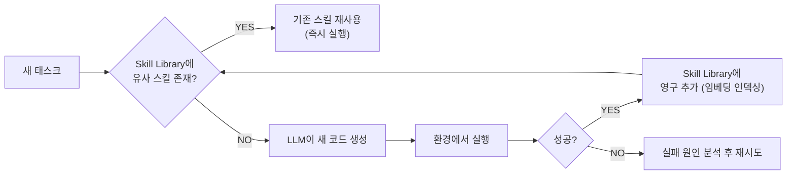
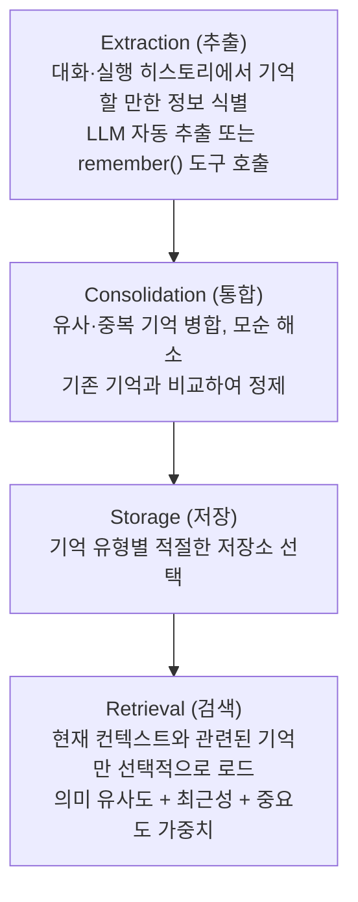

# Agent Memory (에이전트 메모리)

## 개요

**Agent Memory**는 실행 중 얻은 정보를 추출·검증·저장·갱신·삭제하고 다음 행동에 사용하는 lifecycle이다. 저장 위치·scope의 개념은 [[AI/Engineering/Context_Engineering/LLM_Memory|LLM_Memory]]에서 다루며, 이 문서는 운영 정책과 실패 처리에 집중한다.

아래 SDK 조각은 설명용이며 단독 실행 프로그램이 아니다. Provider·저장소 설정과 인증이 필요한 부분은 애플리케이션에서 준비한다. 장기 기억을 저장한다고 모델 가중치가 학습되는 것은 아니다.

## Short-term Memory (단기 기억)

### Conversation History (대화 히스토리)
현재 세션 내 대화 내용. LLM의 컨텍스트 창에 저장:

```python
from langchain_core.messages import HumanMessage, AIMessage

# 대화 히스토리가 누적됨
messages = [
    HumanMessage(content="안녕! 내 이름은 홍길동이야"),
    AIMessage(content="안녕하세요, 홍길동님!"),
    HumanMessage(content="내 이름이 뭔지 기억해?"),
    # LLM은 이 전체 히스토리를 참고하여 "홍길동"이라고 답변
]
```

### In-Context Working Memory
복잡한 태스크 실행 중 중간 결과 저장:
```python
from typing import TypedDict

class AgentState(TypedDict):
    task: str
    plan: list[str]
    completed_steps: list[dict]   # 완료된 단계들의 결과
    tool_outputs: list            # 도구 출력들
    current_hypothesis: str       # 현재 추론 중인 가설
```

### 단기 기억의 한계
- 컨텍스트 창 초과 시 오래된 내용 삭제 필요
- 영속 checkpoint가 없다면 프로세스 종료 후 복구 불가
- 해결책: 대화 요약 + Long-term으로 이관

LangChain v1에서는 Agent state·checkpointer로 thread를 유지하고 trim 또는 summarization middleware로 context를 관리한다. 요약도 모델 호출 비용이 들며 원문 누락을 평가해야 한다. 실행 구성은 [[AI/Engineering/Flow_Engineering/Linear_Flow/LangChain|LangChain]]을 참조한다.

## Long-term Memory (장기 기억)

세션 간 지속되는 외부 저장소 기반 기억.

### Vector-based Memory (벡터 메모리)
의미 검색으로 관련 기억 검색:

검색 구현은 Vector DB별 client로 구성한다. 저장할 때 memory ID를 반환받고, 읽기·수정·삭제 모두 인증된 `(tenant_id, user_id)` 범위로 제한한다. 모델이 생성한 user ID를 접근 권한으로 사용하지 않는다. DB 저장 성공 후 embedding index 갱신이 실패하면 재처리 가능한 event를 남긴다.

### User Profile Memory (사용자 프로필)
사용자 특성·선호도를 구조화된 형태로 저장:

```python
from pydantic import BaseModel, Field
from typing import Optional

class UserProfile(BaseModel):
    user_id: str
    name: Optional[str] = None
    preferred_language: str = "ko"
    expertise_level: str = "intermediate"  # beginner/intermediate/expert
    interests: list[str] = Field(default_factory=list)
    communication_style: str = "formal"    # formal/casual
    
class ProfileMemory:
    def update_from_conversation(self, profile: UserProfile, message: str):
        """대화에서 프로필 자동 업데이트"""
        update_prompt = f"""
        현재 사용자 프로필: {profile.model_dump()}
        새 대화 내용: {message}
        
        프로필 업데이트가 필요한 항목을 JSON으로 반환하세요.
        변경 없으면 빈 객체 {{}} 반환.
        """
        updates = llm_json_output(update_prompt)
        allowed = {"preferred_language", "interests", "communication_style"}
        safe_updates = {k: v for k, v in updates.items() if k in allowed}
        return UserProfile.model_validate({**profile.model_dump(), **safe_updates})
```

### Episodic Memory (에피소딕 메모리)
과거 태스크 실행 기록:

```python
# 성공한 태스크 패턴 저장
episodic_memory.save({
    "task_type": "코드 디버깅",
    "problem": "IndexError in list comprehension",
    "solution_steps": ["인덱스 범위 확인", "len() 사용하여 검증", "try-except 추가"],
    "success": True,
    "time_taken": 120  # 초
})

# 유사한 태스크에서 검색
similar_cases = episodic_memory.search("배열 인덱스 오류")
# → 이전 성공 패턴을 현재 태스크에 적용
```

## Memory as a Tool 패턴

메모리를 에이전트의 도구 중 하나로 등록:

```python
from langchain.tools import tool
from langchain.agents import create_agent

@tool
def remember(content: str) -> str:
    """중요한 정보를 장기 기억에 저장합니다"""
    memory_store.save(content)
    return f"기억 저장됨: {content[:50]}..."

@tool
def recall(query: str) -> str:
    """관련 기억을 검색합니다"""
    memories = memory_store.search(query)
    return "\n".join([m.page_content for m in memories])

# 에이전트가 스스로 기억 저장/검색 결정
agent = create_agent(model=llm, tools=[remember, recall])
```

## MemGPT / Virtual Context Management

Packer et al. (2023, MemGPT 논문, 이후 Letta로 프로젝트명 변경)이 제안한 아키텍처. OS의 **가상 메모리(Virtual Memory)** 개념을 LLM에 그대로 적용한다 — 한정된 컨텍스트 창을 물리 메모리(RAM)로, 외부 저장소를 디스크로 취급한다.

```
OS 가상 메모리 유추:
  RAM (제한적, 빠름)         ↔ Main Context (LLM 컨텍스트 창)
  Disk (거의 무제한, 느림)   ↔ External Context (외부 DB)
  Page Fault (필요 시 로드)  ↔ 함수 호출로 명시적 메모리 인출/저장

MemGPT의 Main Context 구조:
  ┌─────────────────────────────┐
  │ System Instructions (고정)   │
  │ Working Context (핵심 요약)  │ ← LLM이 스스로 편집 가능
  │ FIFO Queue (최근 대화)       │ ← 가득 차면 오래된 것부터 요약 후 축출
  └─────────────────────────────┘
```

핵심 아이디어는 **LLM 스스로가 자신의 메모리를 관리하는 함수를 호출**한다는 점이다 — `core_memory_append()`, `archival_memory_search()` 같은 도구를 self-editing 방식으로 사용해 무엇을 기억에 남기고 무엇을 축출할지 능동적으로 결정한다.

```python
# MemGPT 스타일 self-editing memory 도구 (개념적)
@tool
def core_memory_append(section: str, content: str):
    """working context의 특정 섹션에 정보를 추가한다.
    LLM이 대화 중 중요하다고 판단한 정보를 스스로 여기에 기록"""
    working_context[section] += f"\n{content}"

@tool
def archival_memory_insert(content: str):
    """FIFO 큐에서 축출될 정보를 archival(장기) 저장소로 이관"""
    archival_store.add(content, embed(content))

@tool
def archival_memory_search(query: str, top_k: int = 3):
    """archival 저장소에서 관련 기억 검색 후 컨텍스트에 페이지인(page-in)"""
    return archival_store.search(query, top_k)
```

컨텍스트 창이 가득 차면 시스템이 자동으로 "메모리 압박(memory pressure)" 경고를 LLM에 보내고, LLM이 스스로 무엇을 요약·축출할지 결정한다 — 사람이 개입하지 않는 자기관리형 메모리다.

## Sleep-Time Compute

Letta 팀이 제안한 개념(2025). 에이전트가 **사용자 요청을 기다리는 유휴 시간(idle time)**을 활용해 메모리를 백그라운드로 정리·재구성한다 — 사람이 수면 중 기억을 응고(consolidate)하는 것과 유사한 발상이다.

```
전통적 방식: 매 요청마다 실시간으로 전체 기억을 검색·정리 → 지연시간 증가

Sleep-time Compute:
  유휴 시간에 미리:
    - 대화 기록을 요약·구조화
    - 모순되는 기억을 탐지하고 정리
    - 자주 쓰이는 질의에 대한 답을 미리 계산해 캐싱
  → 실제 요청 시점에는 이미 정리된 메모리만 조회 (지연시간 감소)
```

**효과**: 응답 시점의 지연시간과 토큰 비용을 줄이면서도 메모리 품질(모순 해소, 최신성)을 유지. Runtime Optimization의 캐싱 전략([[AI/Engineering/Loop_Engineering/Runtime_Optimization|Loop_Engineering/Runtime_Optimization]])과 철학이 비슷하지만, 대상이 응답 자체가 아니라 메모리 상태라는 점이 다르다.

## Mem0 — 사실 추출과 갱신

Mem0 논문(2025)은 대화에서 관련 사실을 추출하고 기존 기억과 비교해 저장·갱신하는 구조를 설명한다. Graph 확장은 관계 표현을 보강하는 선택지이며, 모든 기본 설치가 Vector·Graph·KV를 동시에 사용하는 것으로 가정하지 않는다.

평가 결과는 dataset, judge, baseline, retrieval budget에 의존한다. 특정 벤치마크 점수를 일반적인 개인화 정확도로 해석하지 말고 자신의 데이터에서 재현한다. 사용자별 ID를 전달하는 기능과 서버 측 접근 통제는 별개의 책임이다.

## Skill Libraries and Lifelong Learning — Voyager

Wang et al. (2023)이 Minecraft 환경에서 제안한 **평생 학습 에이전트**. 핵심 아이디어는 에이전트가 성공한 행동을 **재사용 가능한 코드 스킬로 라이브러리에 저장**하고, 이후 유사 문제에서 처음부터 다시 추론하지 않고 라이브러리를 검색해 재사용하는 것이다.



```python
class SkillLibrary:
    """Voyager 스타일 코드 스킬 라이브러리"""
    def __init__(self):
        self.skills = {}  # name -> {code, description, embedding}

    def retrieve(self, task_description: str, k: int = 3) -> list:
        """현재 태스크와 의미적으로 유사한 스킬 검색"""
        query_embed = embed(task_description)
        return top_k_by_similarity(query_embed, self.skills, k)

    def add_skill(self, name: str, code: str, description: str):
        """검증된 성공 스킬만 영구 저장 — 실패한 시도는 저장하지 않음"""
        self.skills[name] = {
            "code": code, "description": description, "embedding": embed(description)
        }
```

**Voyager의 3요소**: ① 자동 커리큘럼(Automatic Curriculum) — 현재 상태 기준으로 다음 도전 과제를 스스로 설정, ② 스킬 라이브러리 — 검증된 코드를 영구 축적, ③ 반복 프롬프팅(Iterative Prompting) — 환경 피드백·실행 오류·자기 검증을 결합해 코드를 개선.

**AI Engineering 관점에서의 의의**: 기존 Memory가 "사실을 기억"하는 데 초점을 둔다면, Skill Library는 "능력을 기억"한다 — 에이전트가 시간이 지날수록 더 유능해지는 평생 학습(lifelong learning)의 실용적 구현체다. [[AI/Engineering/Agent_Engineering/Agent_Techniques/Agent_Skills_and_Protocols|Agent_Skills_and_Protocols]]의 Agent Skills와 개념적으로 연결되지만, Voyager의 스킬은 사람이 아니라 **에이전트 스스로 생성·검증·축적**한다는 점이 다르다.

## LangMem과 처리 시점

LangMem은 memory 추출·통합과 관리·검색 tool을 제공한다. 공식 API에는 `create_manage_memory_tool`, `create_search_memory_tool` 등이 있으며 store와 namespace를 구성해 사용한다. API 조각을 적용하기 전 설치 버전과 공식 reference를 대조한다.

- **Hot path:** 현재 응답에 꼭 필요한 갱신을 동기 처리한다. latency 증가와 저장 실패 처리가 필요하다.
- **Background:** 대화 이후 추출·통합한다. 비용을 응답 경로 밖으로 옮길 수 있지만, 새 사실이 보이기까지의 지연과 중복 event를 처리해야 한다.
- Write·Select·Compress는 구현을 설명하는 관점이며, 특정 연구자의 "표준 3-Buckets"로 귀속하지 않는다.

## Memory ETL 파이프라인

메모리는 단순히 저장하고 검색하는 게 아니라, **ETL 파이프라인**처럼 처리 단계가 필요하다:



| 유형 | 저장소 |
|------|--------|
| 의미 검색 | Vector DB (Chroma, Pinecone) |
| 구조화 프로필 | Relational DB |
| 장기 컨텍스트 | Memory Bank (Agent Runtime) |

### Provenance (출처 추적)

기억의 신뢰도·유효성 관리:

```python
class MemoryWithProvenance:
    """출처 정보를 포함한 메모리"""
    
    content: str
    source: str          # 어떤 대화/태스크에서 추출됐는가
    created_at: datetime
    confidence: float    # 추출 신뢰도 (0.0~1.0)
    last_verified: datetime  # 마지막으로 확인된 시점
    
    def is_stale(self, days_threshold: int = 30) -> bool:
        """기억이 오래되어 검증이 필요한지 확인"""
        return (datetime.now() - self.last_verified).days > days_threshold
```

Provenance가 없으면 기억의 신선도를 알 수 없어 오래된 정보로 잘못된 결정을 내릴 수 있다.

## 충돌·삭제·격리 정책

| 단계 | 운영 정책 | 검증할 실패 사례 |
|---|---|---|
| 추출 | 사용자 발언·tool 결과의 source ID와 시각 기록 | 모델의 추정을 사용자 사실로 저장 |
| 갱신 | 관찰 시각과 사실의 유효 시각 구분; 명시적 정정을 반영 | 늦게 도착한 과거 event가 최신 값을 덮어씀 |
| 통합 | 동일 event 중복 처리 방지; 충돌은 provenance 유지 | 서로 다른 사람의 사실을 한 profile로 병합 |
| 조회 | tenant·user·ACL 및 유효 기간 필터 | 유사도 검색 후 권한 검증을 누락 |
| 삭제 | 원본·index·summary·cache까지 삭제 전파 추적 | 삭제한 사실이 summary나 background job에서 재생성 |
| 재처리 | version 또는 tombstone을 확인한 뒤 쓰기 | 오래된 retry가 삭제를 되돌림 |

TTL 만료와 사용자 삭제 요청은 구분한다. Backup 보존 정책도 함께 정의하고, 삭제 완료를 선언할 범위를 명확히 한다. Profile 갱신 시 허용 필드만 반영하고 검증을 통과시킨다. `model_copy(update=...)`만으로 신뢰할 수 없는 갱신값의 validation을 대체하지 않는다.

## 평가와 선택 기준

Memory가 필요한 task와 필요 없는 task를 나눠 baseline을 만든다. 저장 정확도, 관련 기억 recall, 정정 후 응답, 삭제 후 재노출, 사용자 간 누출, 추출·검색 비용과 p95 latency를 함께 측정한다. 근거가 모순되면 최신 timestamp 하나로 확정하지 말고 source와 유효 시점을 확인하거나 사용자에게 확인한다.

Managed Memory Bank를 쓰더라도 retention·access control·consistency 조건을 확인한다. Runtime의 중단 후 재개와 사용자 장기 기억은 다른 기능이며, 인프라 선택은 [[AI/Engineering/Agent_Engineering/Agent_Infrastructure/Agent_Deployment|Agent_Deployment]]에서 다룬다.

## AI Engineering에서의 역할

Agent Memory는 에이전트를 "일회용 도구"에서 "지속 학습하는 어시스턴트"로 만드는 핵심 요소다. 사용자와의 장기 관계 구축, 조직의 노하우 축적, 반복 실수 방지 등 개인화된 AI 경험의 기반이다. 프로덕션에서는 Memory ETL 파이프라인으로 기억의 품질을 관리하고, 영속 저장소·접근 정책·삭제 전파 검증으로 세션 복구와 장기 운영을 지원한다.

## 관련 개념
[[AI/Engineering/Agent_Engineering/Agent_Core_Pillars|Agent_Core_Pillars]] · [[AI/Engineering/Context_Engineering/LLM_Memory|LLM_Memory]] · [[AI/Engineering/Context_Engineering/Semantic_Cache|Semantic_Cache]] · [[AI/Engineering/Context_Engineering/Context_Engineering|Context Engineering]] · [[AI/Engineering/Context_Engineering/Agentic_Context_Management|Agentic_Context_Management]] · [[AI/Engineering/Agent_Engineering/Agent_Techniques/Planning_and_Reflection|Planning_and_Reflection]] · [[AI/Engineering/Agent_Engineering/Agent_Techniques/Agent_Skills_and_Protocols|Agent_Skills_and_Protocols]] · [[AI/Engineering/Agent_Engineering/Agent_Infrastructure/Agent_Deployment|Agent Deployment]]

## 출처
- Weng, L. (2023) "LLM Powered Autonomous Agents" — [lilianweng.github.io](https://lilianweng.github.io/posts/2023-06-23-agent/)
- Packer et al. (2023) "MemGPT: Towards LLMs as Operating Systems" — [arXiv:2310.08560](https://arxiv.org/abs/2310.08560)
- Letta (구 MemGPT) "Sleep-time Compute" — [letta.com/blog](https://www.letta.com/blog/sleep-time-compute)
- Mem0 "Building Production-Ready AI Agents with Scalable Long-Term Memory" — [arXiv:2504.19413](https://arxiv.org/abs/2504.19413) · [mem0.ai](https://mem0.ai)
- Wang et al. (2023) "Voyager: An Open-Ended Embodied Agent with Large Language Models" — [arXiv:2305.16291](https://arxiv.org/abs/2305.16291)
- [[AI/sources/Context_Engineering_Sessions_&_Memory|Context Engineering Sessions & Memory]] (이 위키의 기존 소스, 2025년 11월 최초 발행 → 2026년 5월 업데이트)
- LangMem 문서 — [langchain-ai.github.io/langmem](https://langchain-ai.github.io/langmem/)
- AI Engineering from Scratch, Phase 14 · Lessons 07-10 (MemGPT, Sleep-time Compute, Mem0, Voyager) — [GitHub](https://github.com/rohitg00/ai-engineering-from-scratch/tree/main/phases/14-agent-engineering)

- LangChain, [Short-term memory](https://docs.langchain.com/oss/python/langchain/short-term-memory)
- Pydantic, [Models](https://docs.pydantic.dev/latest/concepts/models/)
