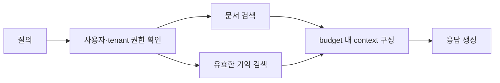

# LLM Memory (LLM 메모리)

## 개요

**LLM Memory**는 이전 상호작용과 지식을 저장하고 선택하여 이후 추론에 제공하는 메커니즘이다. 모델 호출 자체가 이전 요청을 자동으로 기억하는 것은 아니다. 애플리케이션이 어떤 상태를 보존하고 어떤 내용을 다음 context에 넣는지가 연속성을 결정한다.

## 저장 위치와 지속성

아래 네 관점은 저장 위치와 계산 재사용을 비교하기 위한 종합적 설명이다. Lilian Weng(2023)이 제안한 단일 "표준 4분류"가 아니다. Weng의 Agent 개요는 in-context의 short-term memory와 외부 저장소를 이용한 long-term memory를 구분한다.

| 관점 | 담는 것 | 지속성과 한계 |
|---|---|---|
| **In-Context** | 현재 요청에서 모델이 읽는 메시지·검색 결과 | context window에 제한; 원본 저장소가 별도로 있으면 다시 불러올 수 있음 |
| **External** | 대화, 사실, 사용자 profile, task 기록 | DB·파일 등 저장 정책에 따라 지속; retrieval 품질과 접근 통제 필요 |
| **In-Weights** | 학습으로 파라미터에 반영된 패턴·지식 | 일반 추론만으로 갱신되지 않음; 개별 사실의 정확한 조회·삭제를 보장하지 않음 |
| **In-Cache** | attention의 KV 등 재사용 가능한 계산 상태 | runtime·prefix·TTL·eviction 조건에 의존; 사용자 기억 저장소의 대체물이 아님 |

KV Cache는 별도의 의미적 지식을 추가하지 않는다. 계산 상태의 구현은 [[AI/Engineering/Loop_Engineering/Serving_Engineering/Inference_Internals|Inference_Internals]], API 단위 prefix 재사용은 [[AI/Engineering/Prompt_Engineering/Prompt_Caching|Prompt_Caching]]을 참조한다. Provider가 요청 사이의 cache 재사용을 지원할 수 있으므로 "같은 세션에서만 유효"라고 일반화하지 않는다.

## Scope와 수명은 다른 축이다

| Scope | 예시 | 확인할 정책 |
|---|---|---|
| Thread / Session | 현재 대화와 진행 중인 task | thread 소유권, checkpoint 보존 기간 |
| User | 사용자 선호·명시적 사실 | 사용자 간 격리, 정정·삭제 요청 |
| Agent / Application | 재사용 가능한 절차·업무 규칙 | 버전·권한·검토 책임 |
| Organization | 팀 공통 지식 | tenant·role 기반 접근 통제 |

Short-term은 사용 범위를 뜻할 수 있으며, 반드시 프로세스 종료와 함께 소실된다는 뜻은 아니다. 영속 checkpointer가 있으면 thread를 복원할 수 있다. 반대로 long-term이라고 이름 붙여도 in-memory 저장소만 쓰면 재시작 후 사라진다.

## Context에 넣을 기억 선택

| 전략 | 적합한 상황 | 실패 조건 |
|---|---|---|
| 전체 history | 짧은 대화, 원문 보존 중요 | token 비용 증가, context 초과 |
| 최근 window | 최근 사건 위주 작업 | 오래된 제약 누락; K턴이 고정 token 수를 뜻하지 않음 |
| Summary + 최근 원문 | 긴 대화와 제한된 budget | 요약 중 사실·부정·수치 손실 |
| 구조화 profile | 명시적 선호·설정 | 잘못된 추출을 사실로 확정 |
| Retrieval | 큰 episodic/semantic 저장소 | 잘못된 검색, 오래된 사실, 권한 누출 |

메시지를 단순 slice하면 tool call과 대응 result가 분리될 수 있다. 선택·압축 후에도 provider의 메시지 규칙과 필수 system instruction을 유지해야 한다. 상세 context budget 설계는 [[AI/Engineering/Context_Engineering/Agentic_Context_Management|Agentic_Context_Management]]에서 다룬다.

## 구현의 경계

LangChain v1은 Agent state와 checkpointer로 thread-level memory를 구성한다. 과거 `ConversationBufferMemory` 계열을 사용하는 예제는 legacy 버전과 함께 읽어야 한다. 현재 Agent API 예제는 [[AI/Engineering/Flow_Engineering/Linear_Flow/LangChain|LangChain]]을 참조한다.

Letta/MemGPT는 context와 외부 기억 사이의 명시적 이동, Mem0는 사실 추출·갱신, Zep/Graphiti는 시간 정보를 포함한 관계 표현을 살펴볼 수 있는 사례다. 어느 라이브러리를 선택하든 persistence·tenant isolation·삭제 전파·retrieval 평가를 별도로 검증한다. SDK 호출과 운영 lifecycle은 [[AI/Engineering/Agent_Engineering/Agent_Techniques/Agent_Memory|Agent_Memory]]에서 다룬다.

## 기억 내용의 유형

| 유형 | 예시 | 저장 위치와의 관계 |
|---|---|---|
| Episodic | 특정 task의 시도·결과 | 외부 기록에서 검색해 context에 넣을 수 있음 |
| Semantic | 사실·사용자 선호 | source와 유효 시간을 함께 저장 |
| Procedural | 검증된 업무 절차·skill | 버전과 실행 권한이 필요 |
| Working | 현재 계획·중간 결과 | state에 보존하되 필요한 부분만 모델에 제공 |

이 분류는 기억의 **내용**을 설명한다. 저장 위치 분류와 일대일 대응하지 않는다.

## Memory와 RAG

RAG는 정보를 검색해 생성에 제공하는 방식이고, Memory는 무엇을 유지·수정·잊을 것인가를 포함하는 상태 관리 문제다. Memory retrieval에도 RAG를 사용할 수 있다. RAG도 사용자별 ACL과 실시간 갱신을 지원할 수 있으므로 "정적·read-only·모든 사용자 동일"이라는 구분은 적절하지 않다.

## 선택과 평가

단일 질문에 답하는 서비스라면 장기 개인 기억 없이 문서 retrieval만으로 충분할 수 있다. 이전 결정을 계속 유지해야 하는 task는 checkpoint, 여러 thread에 걸친 개인화는 사용자별 기억 저장소가 필요하다.

평가는 기억 recall뿐 아니라 잘못 저장된 사실의 비율, 변경된 사실의 갱신, 오래된 기억의 배제, 삭제 후 재노출, 다른 사용자의 정보 혼입을 포함한다. 검색량 증가만으로 품질이 개선된다고 가정하지 않는다.

## AI Engineering에서의 역할

LLM Memory는 저장된 상태와 현재 추론에 필요한 context를 연결한다. 기억의 양보다 필요한 시점에 올바른 권한으로 유효한 정보를 선택하는 것이 중요하다.

## 관련 개념
[[AI/Engineering/Context_Engineering/Semantic_Cache|Semantic_Cache]] · [[AI/Engineering/Context_Engineering/Context_Engineering|Context Engineering]] · [[AI/Engineering/Context_Engineering/Agentic_Context_Management|Agentic_Context_Management]] · [[AI/Engineering/Agent_Engineering/Agent_Techniques/Agent_Memory|Agent_Engineering/Agent_Memory]] · [[AI/Engineering/Context_Engineering/Retrieval_Strategies/RAG/RAG|RAG]]

## 출처
- Weng, L. (2023), [LLM Powered Autonomous Agents](https://lilianweng.github.io/posts/2023-06-23-agent/)
- LangChain, [Short-term memory](https://docs.langchain.com/oss/python/langchain/short-term-memory)
- Packer et al. (2023), [MemGPT](https://arxiv.org/abs/2310.08560)
- Chhikara et al. (2025), [Mem0](https://arxiv.org/abs/2504.19413)
- Rasmussen et al. (2025), [Zep](https://arxiv.org/abs/2501.13956)
