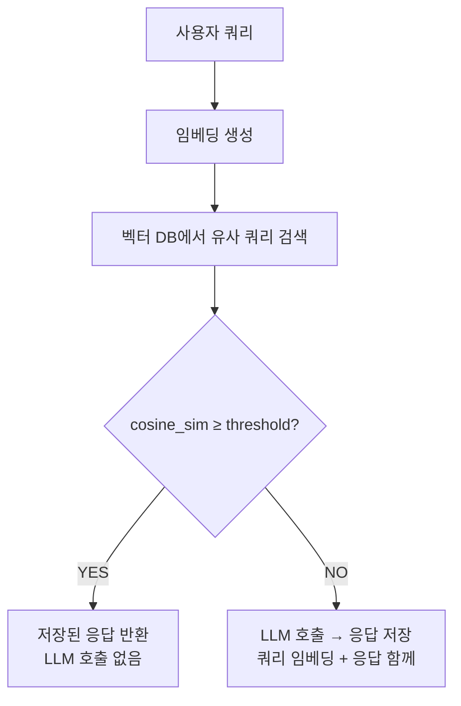

# Semantic Cache (시맨틱 캐시)

## 개요

Semantic Cache는 **의미 유사도 기반 캐싱**으로 LLM API 호출 비용과 레이턴시를 줄이는 최적화 기법이다. 기존 캐시가 완전 일치(Exact Match)만 히트하는 것과 달리, 임베딩 유사도가 임계값을 넘으면 캐시 히트로 처리한다.

```
기존 캐시:
  저장: "파이썬 리스트 정렬 방법" → [LLM 응답]
  새 쿼리: "python에서 list 정렬하는 법" → 캐시 미스 ❌

Semantic Cache:
  "파이썬 리스트 정렬 방법" → embed → [0.2, 0.7, ...]
  "python에서 list 정렬하는 법" → embed → [0.21, 0.68, ...]
  cosine_sim = 0.94 > threshold(0.9) → 캐시 히트 ✅
```

---

## 동작 원리



---

## GPTCache

오픈소스 시맨틱 캐시 라이브러리 (Zilliz 개발) [1]:

```python
from gptcache import cache
from gptcache.adapter.openai import OpenAI as CachedOpenAI
from gptcache.embedding import Onnx
from gptcache.manager import CacheBase, VectorBase, get_data_manager
from gptcache.similarity_evaluation import SearchDistanceEvaluation

# 캐시 초기화
onnx = Onnx()
data_manager = get_data_manager(
    CacheBase("sqlite"),          # 응답 저장
    VectorBase("faiss", dimension=onnx.dimension),  # 임베딩 저장
)
cache.init(
    embedding_func=onnx.to_embeddings,
    data_manager=data_manager,
    similarity_evaluation=SearchDistanceEvaluation(),
    similarity_threshold=0.8,   # 유사도 임계값
)

# 이후 OpenAI API 호출이 자동으로 캐싱됨
response = CachedOpenAI.chat_completions_create(
    model="gpt-4o-mini",
    messages=[{"role": "user", "content": "파이썬 리스트 정렬 방법"}],
)
```

---

## Redis 기반 Semantic Cache 구현

프로덕션 환경에서는 Redis(또는 Qdrant 등 벡터 DB)를 백엔드로 직접 캐시 레이어를 구현할 수 있다:

```python
import numpy as np
from openai import OpenAI


class SemanticCache:
    def __init__(self, threshold: float = 0.9):
        self.client = OpenAI()
        self.threshold = threshold
        self._store: list[tuple[np.ndarray, str]] = []  # 실무에서는 Redis Vector Search 인덱스 사용

    def embed(self, text: str) -> np.ndarray:
        vec = (
            self.client.embeddings.create(input=text, model="text-embedding-3-small")
            .data[0]
            .embedding
        )
        arr = np.asarray(vec, dtype=np.float32)
        return arr / (np.linalg.norm(arr) + 1e-12)

    def get(self, query: str) -> str | None:
        if not self._store:
            return None
        q_vec = self.embed(query)
        best_score, best_resp = max(
            ((float(np.dot(q_vec, k_vec)), resp) for k_vec, resp in self._store),
            key=lambda x: x[0],
        )
        return best_resp if best_score >= self.threshold else None

    def set(self, query: str, response: str) -> None:
        self._store.append((self.embed(query), response))
```

---

## 성능 효과

연구 결과 (GPT Semantic Cache, 2024) [2]:

| 지표 | 수치 |
|------|------|
| 캐시 히트율 | 61.6 ~ 68.8% |
| 히트 정확도 | 97% 이상 |
| 레이턴시 감소 | API 호출 없이 즉시 응답 |
| 비용 절감 | 동일 트래픽 대비 60~70% API 호출 감소 |

---

## 카테고리 인식 캐시 (Category-Aware Cache)

쿼리 유형별 다른 유사도 임계값 적용. 사실 확인 쿼리는 엄격하게, 창작 쿼리는 느슨하게:

```python
thresholds = {
    "factual": 0.95,      # 사실 확인 — 매우 유사해야만 히트
    "creative": 0.70,     # 창작 — 느슨하게 히트
    "code": 0.90,         # 코드 — 언어·목적 유사하면 히트
    "conversation": 0.85  # 대화 — 중간 기준
}
```

---

## 실무 주의사항: False Positive와 캐시 격리

Semantic Cache는 의미 유사도가 높더라도 **결론이 정반대이거나 컨텍스트가 다른 쿼리**에서 오답을 반환(False Positive)할 위험이 있다.

- **부정어·수치 민감성**: `"환불 가능한가요?"`와 `"환불 불가능한가요?"`, `"2025년 매출"`과 `"2026년 매출"`은 임베딩 유사도가 매우 높지만 응답이 달라야 한다. 숫자·날짜·고유명사가 핵심인 쿼리는 임계값을 높게 잡거나(예: 0.95+) 키워드/엔티티 검증을 병행한다.
- **멀티테넌트 및 권한 격리**: 사용자별·테넌트별 접근 권한이 다른 RAG·에이전트 응답을 전역 캐시에 저장하면 데이터 유출(Cache Poisoning)이 발생한다. 캐시 키와 메타데이터 필터에 반드시 `tenant_id` / `user_role` / `prompt_version` / `ttl`을 포함시켜 스코프를 격리해야 한다.
- **멀티턴 대화 문맥**: `"그거 다시 설명해줘"`처럼 직전 턴에 의존하는 발화는 단일 문장 임베딩만으로 캐싱할 수 없으므로, 독립 질의(single-turn)나 재작성(query rewriting)된 완결 질의에만 적용한다.

---

## AI Engineering에서의 역할

Semantic Cache는 **Loop Engineering의 Runtime Optimization** 레이어에서 핵심 역할을 한다 (→ [[AI/Engineering/Loop_Engineering/Runtime_Optimization|Loop_Engineering/Runtime_Optimization]]). 반복적인 질문이 많은 고객 지원, 내부 도구, 교육 플랫폼에서 API 비용을 극적으로 절감한다.

## 관련 개념
[[AI/Engineering/Context_Engineering/LLM_Memory|LLM_Memory]] · [[AI/Engineering/Context_Engineering/Retrieval_Strategies/RAG/Vector_Storage|RAG/Vector_Storage]] · [[AI/Engineering/Loop_Engineering/Runtime_Optimization|Loop_Engineering/Runtime_Optimization]] · [[AI/Engineering/Agent_Engineering/Agent_Techniques/Agent_Memory|Agent_Engineering/Agent_Memory]] · [[AI/Engineering/Prompt_Engineering/Prompt_Caching|Prompt_Engineering/Prompt_Caching]]

## 참고 문헌
1. GPTCache GitHub — [github.com/zilliztech/GPTCache](https://github.com/zilliztech/GPTCache)
2. "GPT Semantic Cache: Reducing LLM Costs and Latency via Semantic Embedding Caching" (2024) — [arXiv:2411.05276](https://arxiv.org/abs/2411.05276)
