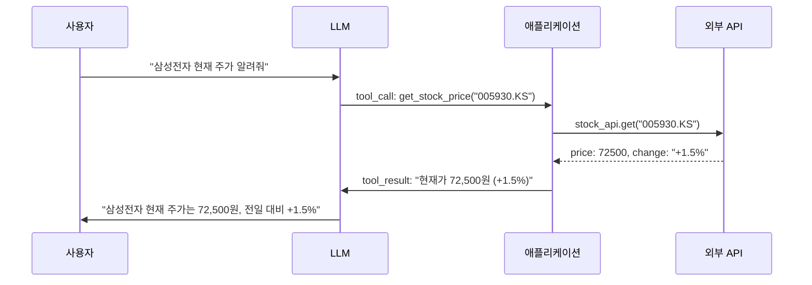

# Tool Use & Function Calling

## 개요

**Tool Use**(또는 Function Calling)는 LLM이 외부 함수·API·도구를 호출하여 자신의 지식 한계를 넘어서는 능력이다. LLM이 "어떤 도구를 어떤 인자로 호출해야 하는지"를 구조화된 형태로 출력하면, 실제 실행은 애플리케이션이 담당하고 결과를 다시 LLM에게 제공한다.

아래의 추가 framework·MCP 코드 조각은 구성 관계를 보여주는 pseudocode이며, 표시되지 않은 저장소·tool·인증 객체는 애플리케이션에서 제공한다.

## 제창 및 역사

- **OpenAI Function Calling** (2023년 6월): Function Calling API 발표
- **Anthropic Tool Use** (2024년 초): Claude에서 공식 지원
- **Google Function Declarations**: Gemini에서 지원
- **MCP (Model Context Protocol)**: Anthropic이 제안한 오픈 도구 표준 (2024) → [[AI/Engineering/Agent_Engineering/Agent_Techniques/Agent_Skills_and_Protocols/MCP|MCP]]

## 작동 원리



## API 구현 예시

다음은 Python 3.12, OpenAI Python SDK 2.54.0의 **Responses API 설명용 예제**다. `OPENAI_API_KEY`와 Function Calling을 지원하는 `OPENAI_MODEL`이 필요하다. Chat Completions의 nested `function` object와 Responses의 flat tool definition을 섞지 않는다. 실제 API 호출은 실행하지 않았으며 SDK request shape와 tool 결과 전달을 mock으로 검증했다.

```python
import json
import os
from openai import OpenAI

client = OpenAI()
tools = [{
    "type": "function",
    "name": "get_weather",
    "description": "Return demo weather data for Seoul in Celsius.",
    "strict": True,
    "parameters": {
        "type": "object",
        "properties": {"city": {"type": "string", "enum": ["Seoul"]}},
        "required": ["city"],
        "additionalProperties": False,
    },
}]

def execute_call(call):
    if call.name != "get_weather":
        return {"error": "unknown_tool"}
    try:
        args = json.loads(call.arguments)
    except (json.JSONDecodeError, TypeError):
        return {"error": "invalid_arguments"}
    if not isinstance(args, dict) or args != {"city": "Seoul"}:
        return {"error": "invalid_arguments"}
    # 고정 fixture이며 외부 날씨 API 결과가 아님
    return {"city": "Seoul", "temperature_c": 20, "source": "demo_fixture"}

history = [{"role": "user", "content": "Use the demo tool for Seoul weather."}]
for step in range(3):
    response = client.responses.create(
        model=os.environ["OPENAI_MODEL"], input=history, tools=tools,
    )
    if response.status != "completed":
        raise RuntimeError("Incomplete model turn")
    # reasoning item을 포함한 전체 output을 다음 입력에 유지
    history.extend(response.output)
    calls = [item for item in response.output if item.type == "function_call"]
    if not calls:
        if not response.output_text:
            raise RuntimeError("No text output; inspect refusal or other output items")
        print(response.output_text)
        break
    for call in calls:
        history.append({
            "type": "function_call_output",
            "call_id": call.call_id,
            "output": json.dumps(execute_call(call)),
        })
else:
    raise RuntimeError("Tool loop budget exhausted")
```

`strict=True`는 인자 schema 준수를 위한 기능이다. Object마다 `additionalProperties: false`와 필수 필드를 명시한다. 실행하는 함수 이름은 allow-list에서 선택하며 모델 문자열을 `eval`로 실행하지 않는다. 예제는 읽기 전용 fixture만 제공하므로 실시간 날씨 정확성을 검증하지 않는다.

Anthropic Messages에서는 tool 정의에 `name`, `description`, `input_schema`를 사용한다. 응답 content의 모든 `tool_use` block을 처리하고 대응하는 ID를 `tool_result.tool_use_id`로 돌려준다. OpenAI의 `call_id`와 형태가 다르며, SDK·endpoint별 공식 문서를 기준으로 adapter를 작성한다.

## 실행 계약과 실패 처리

| 단계 | 확인할 계약 | 실패 처리 |
|---|---|---|
| 도구 선택 | allow-list, 지원되는 tool version | 알 수 없는 tool을 실행하지 않음 |
| 인자 검증 | schema + 업무 invariant | 형식 오류와 업무 거부를 구분 |
| 권한·승인 | 인증된 principal, resource ACL, 필요한 승인 | 모델이 만든 user ID나 승인 문구를 신뢰하지 않음 |
| 실행 | timeout, retry budget, idempotency | 성공 여부 불명확한 write를 곧바로 반복하지 않음 |
| 결과 반환 | 모든 call ID와 result 대응, 크기 제한 | 오류를 구조화해 반환; 민감한 내부 exception은 제거 |

쓰기 작업은 application이 만든 operation ID와 인자 hash, 처리 상태·결과를 영속 저장한다. 동일 operation ID가 다른 인자로 재사용되면 거부한다. 외부 서비스가 idempotency key를 지원하면 같은 업무 작업의 retry에 같은 key를 사용한다. 지원하지 않으면 timeout 후 조회·reconciliation으로 결과를 확인하며, 중복 실행 방지 없이 exactly-once를 약속하지 않는다.

모델의 tool call ID는 대화 내 요청과 결과를 연결하는 식별자다. 모델을 다시 호출하면 새 ID가 생길 수 있으므로 업무 수준 idempotency key를 대신하지 못한다. 승인된 인자가 바뀌면 승인 범위도 다시 평가한다. 반복 상한 외에 전체 deadline과 비용 한도를 둔다.

## Parallel Tool Calling

일부 모델은 한 turn에서 여러 tool call을 요청할 수 있다. 요청 목록을 실제로 병렬 실행할지는 애플리케이션이 결정한다. 의존 관계나 충돌하는 쓰기가 있으면 순차 실행하고, 독립적인 읽기에도 concurrency·timeout 한도를 둔다:
```python
# LLM이 여러 도구 동시 호출 결정
tool_calls = [
    {"name": "get_weather", "args": {"city": "서울"}},
    {"name": "get_news", "args": {"topic": "주식"}},
    {"name": "search_db", "args": {"query": "삼성전자"}}
]
# 세 도구 병렬 실행 → 모든 결과 수집 → 하나의 응답 생성
```

## 도구 설계 모범 사례

```python
# ✅ 좋은 도구 설명
{
    "name": "search_products",
    "description": "제품 데이터베이스에서 제품을 검색합니다. "
                   "제품명, 카테고리, 가격 범위로 필터링 가능합니다.",
    "parameters": {
        "query": "검색어 (예: '블루투스 이어폰')",
        "category": "카테고리 필터 (예: '전자제품'). 선택사항.",
        "max_price": "최대 가격 (원). 선택사항.",
        "limit": "반환할 최대 결과 수 (기본값: 10)"
    }
}

# ❌ 나쁜 도구 설명
{
    "name": "search",  # 너무 모호
    "description": "검색합니다",  # 정보 없음
    "parameters": {"q": "쿼리"}  # 설명 없음
}
```

## 도구 유형 분류

Tool Use에서 사용하는 도구는 **정의 주체와 실행 방식**에 따라 세 가지 유형으로 나뉜다 [1].

### 1. Built-in Tools (내장 도구)

모델 서비스 제공자가 플랫폼 수준에서 제공하는 도구. 개발자가 별도 구현 없이 API 파라미터 하나로 활성화하며, 모델 학습과 긴밀히 통합되어 있다.

| 플랫폼 | 내장 도구 예시 |
|---|---|
| Gemini (Google) | Google Search Grounding, Code Execution, URL Context, Computer Use |
| OpenAI | Web Search, Code Interpreter, File Search |
| Claude (Anthropic) | Computer Use |

**특징**: 구현 불필요, 플랫폼 종속적, 모델과 통합되어 고성능.

### 2. Function Tools (함수 도구)

개발자가 JSON Schema로 정의하고 LLM이 호출 여부·인자를 판단하며, 실제 실행은 애플리케이션 코드가 담당하는 커스텀 도구 [1]. 이 문서의 "작동 원리"와 "API 구현 예시"에서 설명하는 핵심 패턴이다.

```python
# Google ADK 예시: docstring이 description으로 자동 변환
def set_light_values(brightness: int, color_temp: str):
    """거실 조명 밝기와 색온도를 설정합니다.

    Args:
        brightness: 밝기 (0-100%)
        color_temp: 색온도 ("warm" | "cool")
    """
    ...
```

**특징**: 완전한 커스터마이징 가능, 플랫폼 독립적, MCP로 표준화 가능.

### 3. Agent Tools / Sub-Agent (에이전트 도구)

다른 에이전트 전체를 하나의 도구로 추상화하는 방식 [1]. Orchestrator가 전문화된 Sub-Agent를 마치 함수처럼 호출하며, A2A(Agent-to-Agent) 프로토콜로 원격 에이전트도 도구화할 수 있다.

```python
# Google ADK: AgentTool로 Sub-Agent를 도구로 wrap
from google.adk.tools import AgentTool

research_agent = LlmAgent(name="researcher", tools=[search_tool])
writer_agent = LlmAgent(
    name="writer",
    tools=[AgentTool(agent=research_agent)]  # Sub-Agent를 도구로
)
```

**특징**: 복잡한 태스크를 전문 에이전트에게 위임, 재귀적 구성 가능, 에이전트 간 책임 분리.

→ 자세한 내용: [[AI/Engineering/Agent_Engineering/Agent_Architectures|Agent_Architectures]] (Orchestrator & Sub-Agents 패턴), [[AI/Engineering/Agent_Engineering/Agent_Techniques/Agent_Skills_and_Protocols/A2A|Agent_Skills_and_Protocols/A2A]]

---

## 도구의 기능별 Use Case

도구가 수행하는 역할에 따라 네 가지 범주로 분류된다 [1][2].

### 1. 정보 검색 (Information Retrieval)

외부 지식 소스에서 데이터를 가져오는 도구. LLM의 학습 시점 이후 최신 정보나 내부 데이터에 접근한다.

- **예시**: [[AI/Engineering/Agent_Engineering/Agent_Techniques/Agent_Skills_and_Protocols/MCP|MCP]] Toolbox, [[AI/Engineering/Context_Engineering/Retrieval_Strategies/NL2SQL/NL2SQL|NL2SQL]](자연어 → SQL 변환), [[AI/Engineering/Context_Engineering/Retrieval_Strategies/RAG/RAG|RAG]](벡터 DB 검색), [[AI/Engineering/Context_Engineering/Retrieval_Strategies/GraphRAG/Knowledge_Graph/Knowledge_Graph|Knowledge Graph]] 조회
- **특징**: 일반적으로 읽기 중심이지만 조회 로그·비용·데이터 유출 가능성은 남음; 권한과 freshness를 고려해 캐싱

### 2. API 연결 (API Integration)

외부 서비스 API를 호출하여 실시간 데이터를 가져오거나 단순 액션을 실행하는 도구.

- **예시**: 날씨 API, 주식 시세 API, 결제 API, GitHub REST API
- **특징**: 실시간 데이터 접근, 인증(API Key/OAuth) 필요, 멱등성 고려

### 3. 시스템 통합 (System Integration)

기업 내부 시스템이나 SaaS 서비스와 연결하여 실질적인 액션을 수행하는 도구.

- **예시**: Gmail, Google Drive, Calendar, Slack, Jira, Salesforce (Google Connectors 등)
- **특징**: 영구적 사이드 이펙트(이메일 전송·파일 수정 등), 세밀한 권한 관리 필수, HITL 검토 권장

### 4. Human-in-the-Loop (HITL) ([[AI/Engineering/Flow_Engineering/Graph_Flow/Human_in_the_Loop|Human_in_the_Loop]])

에이전트가 자율 판단하기 어려운 단계에서 인간의 승인·입력을 요청하는 도구 [1][2].

```python
def ask_for_confirmation(action: str, details: dict) -> bool:
    """비가역적 액션 전 인간 승인을 요청합니다"""
    # UI에 승인 다이얼로그 → 사용자 응답 대기
    return user_approved

def ask_for_input(prompt: str) -> str:
    """에이전트가 결정할 수 없는 정보를 사용자에게 요청합니다"""
    ...
```

- **사용 시점**: 비가역적 작업(대량 이메일 발송, 파일 삭제), 민감 데이터 접근, 모델 확신도 낮을 때
- **특징**: 자율성과 안전성의 균형, [[AI/Engineering/Agent_Engineering/Agent_Techniques/Agent_Skills_and_Protocols/MCP|MCP]] Sampling primitive와 연계 가능

---

## Tool Use와 Agent의 관계

Tool Use는 [[AI/Engineering/Agent_Engineering/Agent_Engineering|Agent Engineering]]의 핵심 구성 요소다:
```
Agent = LLM + Tools + Memory + Planning
              ↑
          Tool Use가 여기서 실제 세계와의 인터페이스 제공
```

ReAct 에이전트 루프:
```
생각(Thought) → 행동(Action: 도구 호출) → 관찰(Observation: 결과) → 반복
```

## MCP: Function Calling의 표준화 레이어

Function Calling은 각 모델(OpenAI, Anthropic, Google)마다 API 형식이 다르고, 도구마다 커스텀 통합 코드가 필요하다는 한계가 있다. Anthropic은 2024년 11월 이를 해결하는 오픈 표준을 발표했다.

**MCP (Model Context Protocol)**는 "어떤 LLM이든 표준화된 방식으로 외부 도구·서비스와 통신한다"는 프로토콜이다:

```
Function Calling (모델별 상이):
  OpenAI 방식: tools=[{"type": "function", "function": {...}}]
  Anthropic 방식: tools=[{"name": ..., "input_schema": {...}}]
  → 모델별 request/response adapter가 필요할 수 있음

MCP (표준화):
  MCP Server 한 번 구현 → Claude, GPT-4, Gemini 모두 사용 가능
  → Host가 모델별 호출 형식과 MCP 요청을 연결
```

MCP의 4가지 Primitive 중 **Tools**가 Function Calling과 직접 대응하며, 추가로 **Resources**(데이터 노출), **Prompts**(템플릿), **Sampling**(서버→LLM 요청)을 제공한다.

→ 자세한 내용: [[AI/Engineering/Agent_Engineering/Agent_Techniques/Agent_Skills_and_Protocols/MCP|Agent_Skills_and_Protocols/MCP]]

---

## Code Execution with MCP / Progressive Tool Disclosure

MCP가 도구 통합을 표준화했지만, 새로운 병목이 뒤따랐다: 연결된 MCP 서버가 늘어날수록 **도구 스키마 자체가 컨텍스트를 잠식**한다. 모든 schema를 미리 주입하는 설계에서는 사용하지 않는 도구도 context를 차지한다. 실제 token 수는 schema 길이와 선택·cache 정책에 따라 달라진다.

```
기존 방식 — 모든 도구 스키마를 매번 컨텍스트에 주입:
  [도구1 스키마] + [도구2 스키마] + ... + [도구38 스키마] + [사용자 질문]
  → 38개 도구 정의가 전부 컨텍스트를 차지, 실제 쓰는 건 1~2개뿐
```

이를 해소하는 접근이 스펙트럼 위 세 지점으로 수렴하고 있다.

### 1. Code Execution with MCP (Anthropic)

LLM에게 도구를 직접 노출하는 대신, **샌드박스에서 실행되는 코드가 도구를 호출**하게 한다. 모델은 도구 스키마 전체가 아니라 도구 이름 목록만 보고, 필요한 도구를 코드에서 함수처럼 불러 쓴다.

```python
# 모델이 생성하는 코드 — 도구는 RPC로 호출됨
from mcp_tools import search_web, read_file, send_email

results = search_web(query="2026 AI 트렌드")
top_result = results[0]
send_email(to="team@company.com", body=f"조사 결과: {top_result}")
# → 실행 결과만 모델에게 반환, 중간 도구 스키마는 컨텍스트에 없음
```

절감 효과는 원래 노출하던 schema와 중간 결과의 크기에 의존한다. 같은 task 성공률을 유지하는지 확인하면서 입력 token, code execution 비용, latency를 함께 측정한다.

### 2. Code Mode (Cloudflare)

같은 발상을 워커 런타임에 적용한 구현체. MCP 도구를 TypeScript 함수로 변환해 모델이 코드로 호출하게 한다는 점에서 Anthropic 접근과 같은 지점 위에 있다.

### 3. Tool Search / Progressive Disclosure

도구를 코드화하지 않고, 대신 **필요할 때만 도구 설명을 검색해 불러오는** 방식. 처음에는 도구 이름만 노출하고, 모델이 "이 작업엔 이 도구가 필요하다"고 판단하면 그때 해당 도구의 전체 스키마를 검색해 컨텍스트에 추가한다 — [[AI/Engineering/Context_Engineering/Retrieval_Strategies/Retrieval_Strategies|Retrieval Strategies]]의 Select 전략을 도구 정의 자체에 적용한 것이다.

이 세 접근은 도구 스키마 팽창이라는 같은 문제를 서로 다른 트레이드오프로 푼다: Code Execution은 중간 데이터 처리를 모델 밖으로 옮길 수 있지만 샌드박스 인프라가 필요하고, Tool Search는 인프라 부담이 적지만 검색 지연이 추가된다. 비용 관점의 후속 분석은 [[AI/Engineering/Loop_Engineering/Cost_Engineering/Context_Usage_Auditing|Cost_Engineering/Context_Usage_Auditing]] 참고.

---

## AI Engineering에서의 역할

Function Calling은 LLM을 "텍스트 생성기"에서 "실제 행동 실행자"로 전환시키는 핵심 기술이다. 검색, DB 조회, API 호출, 코드 실행 등 많은 외부 상호작용을 구조화된 요청과 결과로 연결한다. Structured Output([[AI/Engineering/Prompt_Engineering/Structured_Output|Structured_Output]])과 schema 제약을 공유하지만, 실행 권한·side effect 관리는 별도의 계약이다. MCP는 도구 discovery와 통신을 표준화하며 모델별 API adapter를 대체하지 않는다.

## 관련 개념
[[AI/Engineering/Prompt_Engineering/Structured_Output|Structured_Output]] · [[AI/Engineering/Flow_Engineering/Graph_Flow/ReAct_Pattern|ReAct_Pattern]] · [[AI/Engineering/Agent_Engineering/Agent_Core_Pillars|Agent_Core_Pillars]] · [[AI/Engineering/Flow_Engineering/Linear_Flow/LangChain|LangChain]] · [[AI/Engineering/Agent_Engineering/Agent_Techniques/Agent_Skills_and_Protocols/MCP|Agent_Skills_and_Protocols/MCP]] · [[AI/Engineering/Loop_Engineering/Cost_Engineering/Context_Usage_Auditing|Loop_Engineering/Cost_Engineering/Context_Usage_Auditing]]

## 출처
- OpenAI Function Calling 문서 — [platform.openai.com](https://platform.openai.com/docs/guides/function-calling)
- Anthropic Tool Use 문서 — [docs.anthropic.com](https://docs.anthropic.com/en/docs/build-with-claude/tool-use)
- Anthropic (2024) "Introducing the Model Context Protocol" — [anthropic.com](https://www.anthropic.com/news/model-context-protocol)
- Anthropic (2025) "Equipping Agents for the Real World with Agent Skills" — [anthropic.com](https://www.anthropic.com/engineering/equipping-agents-for-the-real-world-with-agent-skills)
- Anthropic "Code execution with MCP: Building more efficient agents" — [anthropic.com/engineering](https://www.anthropic.com/engineering/code-execution-with-mcp)
- Cloudflare "Code Mode: the better way to use MCP" — [blog.cloudflare.com](https://blog.cloudflare.com/code-mode/)

## References

[1] Mike Styer et al. (Google), "Agent Tools & Interoperability with Model Context Protocol (MCP)" — [kaggle.com](https://www.kaggle.com/whitepaper-agent-tools-and-interoperability-with-mcp) (2025년 11월 최초 발행, 2026년 5월 업데이트) · 이 위키: [[AI/sources/Agent_Tools_&_Interoperability_with_Model_Context_Protocol_(MCP)|Agent Tools & MCP]]

[2] Kaggle 5-Day Gen AI Course (2026년 5월), "Agent Tools" (Day 2) — `raw/kaggle/2026may/2025_Day_2_Rewrite_v1_AgentTools.pdf`

- OpenAI, [Function calling](https://developers.openai.com/api/docs/guides/function-calling) (2026-11-01 확인)
