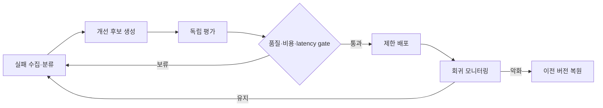

# Continuous Optimization (지속적 최적화)

## 개요

**Continuous Optimization**은 프로덕션 실패를 수집하고 개선 후보를 독립적으로 평가한 뒤, 제한된 배포와 rollback으로 검증하는 운영 루프다. Prompt, retrieval, 모델 가중치, tool, memory 등 무엇을 바꾸더라도 평가 기준과 변경 이력을 함께 관리해야 한다.

Prompt optimizer의 선택과 DSPy 컴파일 예제는 [[AI/Engineering/Prompt_Engineering/Automatic_Prompt_Optimization|Automatic_Prompt_Optimization]], 학습 objective는 [[AI/Engineering/Model_Engineering/Training_and_Tuning/Full_Fine-Tuning|Full_Fine-Tuning]], harness 전체의 탐색은 [[AI/Engineering/Loop_Engineering/Self_Evolving_Harnesses|Self_Evolving_Harnesses]]에서 다룬다.

## 실패에서 배포까지



1. **실패 수집:** task 성공 여부, tool 오류, 사용자 수정, 비용·latency를 함께 기록한다. 개인정보는 수집 단계부터 최소화한다.
2. **후보 생성:** 실패 원인에 맞춰 prompt·retrieval·tool·모델 중 변경 대상을 정한다. 검색 누락을 prompt 최적화만으로 해결하려 하지 않는다.
3. **독립 평가:** 같은 입력과 평가 rubric으로 baseline과 후보를 비교한다. 품질 평균뿐 아니라 실패 유형별 회귀를 확인한다.
4. **제한 배포:** 정해진 cohort에 배포하고 품질·안전·latency·비용 한도를 감시한다.
5. **Rollback:** 모델뿐 아니라 prompt, retrieval 설정, tool schema를 포함한 호환 가능한 버전 묶음을 복원한다.

## 데이터 누수와 평가 계약

Train은 후보 학습에, development/validation은 후보 선택에, held-out test는 최종 평가에 사용한다. 같은 사용자·대화·문서의 유사 사례가 여러 split에 걸치면 독립 평가가 깨질 수 있으므로 그룹 또는 시간 기준으로 분리한다. Test 결과를 보고 반복 수정했다면 그 집합은 더 이상 untouched test가 아니다.

평가 전에 primary metric, 최소 실질 효과, 표본 크기·실험 기간, guardrail, 중단 규칙을 정한다. Prompt 후보를 많이 비교할수록 우연히 높은 점수가 나올 수 있으므로 다중 비교와 반복 관찰을 고려한다. LLM judge를 쓴다면 judge 모델·rubric도 고정하고 사람 평가로 보정한다.

## A/B 테스트 예제

다음 코드는 **독립적인 두 집단의 연속형 품질 점수**를 비교하는 실행 가능한 교육용 예제다. Python 3.12, SciPy 1.18.1에서 검증했다. 기본 `min_samples=30`은 실행을 위한 예시 값이며 검정력 분석으로 정한 표본 크기가 아니다. 실서비스에서는 사전 계산한 값을 전달한다. 같은 문제에 대한 paired 비교나 사용자별 반복 측정에는 이 검정을 그대로 사용하지 않는다.

라우팅은 애플리케이션에서 사용자 단위로 고정한다. 이 예제는 이미 수집된 점수만 분석하며, 유의하지 않거나 데이터가 부족하면 `winner=None`을 반환한다. 비용·latency gate를 통과하기 전 자동 배포하지 않는다.

```python
from math import isfinite
from statistics import mean, variance
from scipy.stats import ttest_ind

class ABTestRunner:
    def __init__(self, model_a, model_b, min_samples=30, alpha=0.05, min_effect=0.02):
        if min_samples < 2 or not 0 < alpha < 1 or min_effect < 0:
            raise ValueError("Invalid experiment configuration")
        self.model_a, self.model_b = model_a, model_b
        self.min_samples, self.alpha, self.min_effect = min_samples, alpha, min_effect
        self.results = {"a": [], "b": []}

    def record(self, model_choice: str, quality_score: float):
        if model_choice not in self.results or not isfinite(quality_score):
            raise ValueError("Invalid score or cohort")
        self.results[model_choice].append(quality_score)

    def analyze(self) -> dict:
        a, b = self.results["a"], self.results["b"]
        if any(not isfinite(x) for x in a + b):
            raise ValueError("Scores must be finite")
        result = {
            "model_a_avg": mean(a) if a else None,
            "model_b_avg": mean(b) if b else None,
            "p_value": None, "significant": False, "winner": None,
            "status": "insufficient_data",
        }
        if min(len(a), len(b)) < self.min_samples:
            return result
        if variance(a) == 0 or variance(b) == 0:
            return {**result, "status": "degenerate_data"}
        p = float(ttest_ind(a, b, equal_var=False).pvalue)
        delta = result["model_b_avg"] - result["model_a_avg"]
        significant = isfinite(p) and p < self.alpha
        winner = None
        if significant and abs(delta) >= self.min_effect and delta != 0:
            winner = "b" if delta > 0 else "a"
        return {
            **result, "p_value": p if isfinite(p) else None,
            "significant": significant, "winner": winner,
            "status": "candidate" if winner else "inconclusive",
        }

runner = ABTestRunner(None, None)
runner.results = {
    "a": [0.9] + [0.1, 0.2] * 25,
    "b": [0.1] + [0.8, 0.9] * 25,
}
print(runner.analyze()["winner"])  # b: 첫 원소가 아니라 평균으로 비교
```

예상 출력은 `b`다. 리스트의 대소 비교는 첫 원소부터 비교하는 사전식 순서이므로 평균 품질 비교에 사용할 수 없다.

## 변경 단위와 Rollback

| 변경 대상 | 함께 기록할 것 | 실패 시 대응 |
|---|---|---|
| Prompt / DSPy artifact | 모델 ID, prompt hash, data split, metric | 이전 artifact 복원 |
| Retrieval | embedding model, index version, chunking/filter | index와 query 측 설정을 함께 복원 |
| Fine-tuning | base model, dataset, objective, checkpoint | baseline으로 traffic 복원 |
| Tool / Memory | schema, policy, data migration | 외부 side effect와 데이터 호환성 별도 확인 |

## RLVR과 Test-Time Compute의 위치

RLVR은 검증 가능한 보상을 사용하는 학습 설정이고, GRPO는 업데이트 알고리즘이다. 두 용어를 동의어로 취급하지 않는다. Verifier 설계와 reward hacking은 [[AI/Engineering/Loop_Engineering/RL_Environments|RL_Environments]], 학습 방식은 Full Fine-Tuning의 관련 절을 참조한다.

Test-Time Compute는 추론 시 후보 생성·탐색·검증에 계산을 배분하는 방법으로 학습과 별개의 축이다. 계산량을 늘려도 품질이 반드시 좋아지는 것은 아니다. Task별 성공률과 token cost·p95 latency를 측정하고 추가 계산의 한계 효과로 budget을 정한다.

## AI Engineering에서의 역할

Continuous Optimization은 개선 아이디어를 검증 가능한 배포 변경으로 연결한다. 후보의 최고 점수보다 재현성, held-out 성능, rollback 가능성을 우선한다.

## 관련 개념
[[AI/Engineering/Loop_Engineering/Data_Flywheel|Data_Flywheel]] · [[AI/Engineering/Loop_Engineering/Runtime_Optimization|Runtime_Optimization]] · [[AI/Engineering/Loop_Engineering/RL_Environments|RL_Environments]] · [[AI/Engineering/Harness_Engineering/Harness_Evaluation/LLM_as_a_Judge|LLM_as_a_Judge]] · [[AI/Engineering/Harness_Engineering/Harness_Evaluation/Benchmarking|Benchmarking]] · [[AI/Engineering/Model_Engineering/Training_and_Tuning/PEFT_LoRA_QLoRA|PEFT_LoRA_QLoRA]] · [[AI/Engineering/Graph_Engineering/Loop_Networks_and_Anchors|Graph_Engineering/Loop_Networks_and_Anchors]] · [[AI/Engineering/Loop_Engineering/Cost_Engineering/Cost_Engineering|Cost_Engineering/Cost_Engineering]] · [[AI/Engineering/Loop_Engineering/Self_Evolving_Harnesses|Self_Evolving_Harnesses]]

## 출처
- SciPy, [ttest_ind](https://docs.scipy.org/doc/scipy/reference/generated/scipy.stats.ttest_ind.html) — Welch 검정과 독립 표본 가정
- Khattab et al. (2023), [DSPy](https://arxiv.org/abs/2310.03714)
- Shao et al. (2024), [DeepSeekMath](https://arxiv.org/abs/2402.03300)
- DeepSeek-AI (2025), [DeepSeek-R1](https://arxiv.org/abs/2501.12948)
