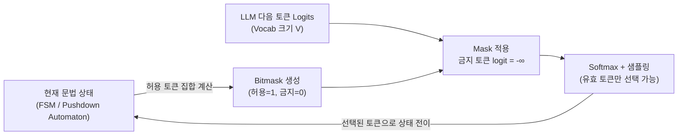

# Constrained Decoding (제약 디코딩)

## 개요

**Constrained Decoding**(Grammar-Guided / Structured Decoding)은 LLM이 토큰을 하나씩 샘플링하는 디코딩 루프 내부에서, **사전 정의된 정규표현식(Regex)이나 문맥 자유 문법(CFG)을 위반하는 토큰의 확률(logit)을 $-\infty$로 마스킹**하여 구문 오류 가능성을 수학적으로 0%로 만드는 서빙 엔진 기술이다. [[AI/Engineering/Prompt_Engineering/Structured_Output|Structured_Output]]이 애플리케이션 계층의 JSON/Schema/의미 검증 계약을 다룬다면, 이 문서는 **서빙 엔진이 토큰 레벨에서 그 구조를 실제로 강제하는 메커니즘**을 다룬다.

## 작동 원리: FSM / PDA 기반 Logit Masking

1. **문법 컴파일**: JSON Schema, 정규표현식, 또는 EBNF 문법을 유한 상태 기계(FSM)나 푸시다운 오토마톤(PDA)으로 컴파일한다.
2. **스텝별 비트마스크 적용**: 매 디코딩 스텝마다 현재 상태에서 전이 가능한 토큰만 `True`인 어휘 크기(예: 128K) 비트마스크를 적용해 금지 토큰의 확률을 0으로 만든다.

## 핵심 엔지니어링 난제와 해법

### 1. 토크나이저 경계 불일치 (Token Boundary Mismatch)
BPE 같은 subword 토크나이저에서는 `"name": "`나 `": 123,`처럼 **하나의 토큰이 여러 JSON 구문 요소를 가로질러** 포함된다. 따라서 문자 단위 상태 전이를 그대로 적용할 수 없으며, 오프라인/초기화 단계에서 **어휘 전체(Vocabulary)의 각 토큰이 FSM 상태를 어떻게 전이시키는지 미리 인덱싱(Precomputed Transition Table / Vocabulary Trie)** 해야 추론 중 지연을 없앨 수 있다.

### 2. Jump-Forward Decoding (결정론적 토큰 압축)
JSON 출력에서 `{"user_id": ` 또는 닫는 괄호 `"}` 처럼 현재 문법 상태에서 **다음에 올 문자열이 단 하나로 고정된 구간**이 자주 등장한다.
- **Jump-Forward**: 이런 확정 구간에서는 LLM의 GPU forward pass를 생략하고 확정된 문자열을 한 번에 컨텍스트에 붙여 넣은 뒤 Prefill(또는 Speculative 검증)로 넘긴다. 이로 인해 잘 구현된 제약 디코딩은 비제약 디코딩보다 **오히려 지연시간이 더 짧아지는 역전 현상**도 발생한다 [1][2].

## 주요 엔진 비교

| 엔진 | 핵심 기법 | 채택 서빙 스택 | 특징 |
|---|---|---|---|
| **Outlines** (`dottxt-ai`) | Regex → FSM + 어휘 인덱스 사전 컴파일 | 초기 vLLM, 독립 라이브러리 | 제약 디코딩 대중화, JSON Schema·Regex 지원 |
| **XGrammar** | 문맥 독립 토큰 사전 분류 + 적응형 푸시다운 오토마톤 | **vLLM / SGLang 기본 엔진** | 토큰당 마스크 생성 <40μs 수준, 중첩 CFG 고속 처리 [3] |
| **llguidance** | Earley 파서 기반 저오버헤드 스캐너 + Jump-Forward | **OpenAI Structured Outputs**, vLLM 옵션 | 복잡한 재귀 문법·초저지연 초기화에 강점 |
| **llama.cpp GBNF** | BNF 문법 파일 기반 스택 파서 | llama.cpp / Ollama | 로컬·CPU/Apple Silicon 환경에서 경량 동작 |

## 주의사항: 분포 왜곡(Distribution Distortion)

구문 오류를 0으로 만들어주지만, **의미 품질까지 자동으로 보장하지는 않는다**.
- **조기 문법 강제의 함정**: 모델이 아직 추론을 마치지 않았는데 바로 `{"answer":` 같은 JSON 필드를 강제하면, 모델이 생각할 토큰 공간을 잃고 부정확한 값을 억지로 채워 넣을 수 있다. Reasoning/CoT가 필요한 태스크는 `thinking` 필드나 비제약 추론 구간을 먼저 허용한 뒤 최종 JSON만 제약 디코딩으로 뽑는 것이 표준 패턴이다.
- **토큰화 편향**: 특정 공백이나 따옴표 결합 토큰이 마스킹되면서 모델의 원래 확률 분포가 미묘하게 왜곡될 수 있으므로, 엄격한 스키마가 필요한 구간에만 선택적으로 활성화해야 한다.

## 경계 정리

| 문서 | 다루는 것 |
|---|---|
| **본 문서 (Constrained_Decoding)** | 서빙 엔진 내부의 **FSM/PDA 로짓 마스킹, 어휘 인덱싱, Jump-Forward, XGrammar/Outlines** |
| [[AI/Engineering/Prompt_Engineering/Structured_Output\|Structured_Output]] | 애플리케이션 계층의 **JSON/Schema/의미 검증 분리**, API 계약과 실패 처리 |
| [[AI/Engineering/Loop_Engineering/Serving_Engineering/Inference_Internals\|Inference_Internals]] | KV Cache, PagedAttention, RadixAttention 등 일반 추론 루프 최적화 |

## AI Engineering에서의 역할

Constrained Decoding은 에이전트의 도구 호출(Function Calling), 엔터프라이즈 데이터 추출(ETL), NL2SQL 구문 보장 파이프라인의 **신뢰성 하부 구조**다. 과거 정규식 재시도 루프(retry loop)로 해결하던 파싱 실패를 서빙 엔진 단계에서 원천 차단하고, Jump-Forward를 통해 불필요한 디코딩 스텝까지 절약한다.

## 관련 개념
[[AI/Engineering/Prompt_Engineering/Structured_Output|Structured_Output]] · [[AI/Engineering/Loop_Engineering/Serving_Engineering/Inference_Internals|Inference_Internals]] · [[AI/Engineering/Loop_Engineering/Serving_Engineering/Serving_Engineering|Serving_Engineering]] · [[AI/Engineering/Flow_Engineering/Linear_Flow/Tool_Use_and_Function_Calling|Tool_Use_and_Function_Calling]]

## 출처
- [1] Willard & Louf (2023) "Efficient Guided Generation for Large Language Models (Outlines)" — [arXiv:2307.09702](https://arxiv.org/abs/2307.09702)
- [2] Zheng et al. (2024) "SGLang: Efficient Execution of Structured Language Model Programs" — [arXiv:2312.07104](https://arxiv.org/abs/2312.07104)
- [3] Dong et al. (2024) "XGrammar: Flexible and Efficient Structured Generation Engine for Large Language Models" — [arXiv:2411.15100](https://arxiv.org/abs/2411.15100)
- Microsoft "llguidance" — [github.com/guidance-ai/llguidance](https://github.com/guidance-ai/llguidance)
