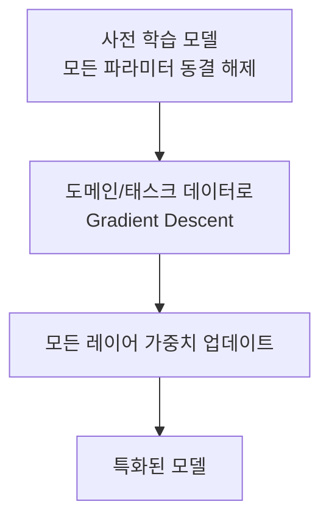
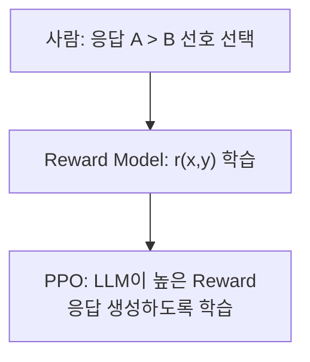

# Full Fine-Tuning

## 개요

**Full Fine-Tuning**은 사전 학습된 모델의 **모든 파라미터**를 태스크·도메인 특화 데이터로 재학습하는 기법이다. 업데이트할 파라미터 범위를 정의하는 용어이며, 학습 objective를 정의하는 용어는 아니다. SFT·DPO·RL은 Full FT와 PEFT 양쪽에 적용할 수 있다. 성능과 비용은 데이터·모델·훈련 설정에 따라 달라진다.

## 작동 원리



### SFT (Supervised Fine-Tuning)

가장 일반적인 Full FT 형태. 입력→출력 쌍으로 지도 학습:

```python
# 훈련 데이터 예시 (Instruction Tuning 형식)
{
    "instruction": "다음 계약서를 검토하고 위험 조항을 찾아라.",
    "input": "<계약서 내용>",
    "output": "위험 조항 1: 5조 3항 - 일방적 해지 조건..."
}
```

### RLHF (Reinforcement Learning from Human Feedback)

OpenAI의 InstructGPT, ChatGPT에 사용된 기법:

1. **SFT 단계**: 고품질 시연 데이터로 기초 모델 학습
2. **Reward Model 학습**: 인간 평가자가 응답 쌍을 비교 → 선호도 레이블 → Reward Model 학습
3. **PPO 최적화**: RL(PPO 알고리즘)로 Reward를 최대화하도록 LLM 파인튜닝



**DPO (Direct Preference Optimization)**: RLHF의 Reward Model 학습을 생략하고 직접 선호도 데이터로 최적화. 별도 reward model·PPO loop를 두지 않는 직접 선호 최적화 방식이며, 안정성과 성능은 데이터·설정에 따라 달라진다.

### 계보의 다음 단계: GRPO / RLVR

**GRPO(Group Relative Policy Optimization)**는 DeepSeekMath(2024)에서 제안된 PPO 계열 알고리즘이다. 같은 prompt에서 생성한 응답 그룹의 reward 평균과 표준편차를 이용해 advantage를 추정하므로 별도의 value model을 두지 않는다. 단순한 순위 기반 업데이트가 아니며, critic을 없앴다고 학습 안정성이 항상 보장되는 것도 아니다.

**RLVR(Reinforcement Learning with Verifiable Rewards)**은 정답 검증기·실행 테스트 등으로 reward를 계산하는 학습 설정이다. GRPO와 RLVR은 각각 알고리즘과 reward 구성 방식으로 서로 다른 축이다. DeepSeek-R1(2025)은 이러한 접근을 reasoning 학습에 활용한 사례다. Verifier의 누락·편법과 reward hacking을 평가해야 한다.

운영 데이터로 후보를 만들고 검증·배포하는 과정은 [[AI/Engineering/Loop_Engineering/Continuous_Optimization|Continuous_Optimization]], verifier와 환경 설계는 [[AI/Engineering/Loop_Engineering/RL_Environments|RL_Environments]]에서 다룬다.

## Full FT vs PEFT 비교

| 기준 | Full Fine-Tuning | PEFT (LoRA 등) |
|------|-----------------|---------------|
| **학습 파라미터** | 전체 파라미터 | 일부 adapter 등; 비율은 rank·target module에 의존 |
| **GPU 메모리** | 전체 gradient·optimizer 상태 필요 | 학습 상태는 줄지만 base model·activation 메모리는 필요 |
| **성능** | 더 넓은 파라미터 변경 가능; 항상 우수하지는 않음 | 데이터·rank·태스크에 따라 Full FT와 비교 필요 |
| **학습 시간** | 모델·병렬화·sequence length에 의존 | optimizer 부담은 작지만 forward/backward 비용은 남음 |
| **Catastrophic Forgetting** | 발생 가능; 원래 능력 회귀 평가 필요 | PEFT에서도 발생 가능; 별도 평가 필요 |
| **적합 케이스** | 전체 업데이트의 이득이 비용을 정당화하는 task | 제한된 학습 자원에서 adapter 효과를 검증할 task |

## 적합한 상황

- 모델의 근본적인 행동 패턴을 변경해야 할 때 (안전성, 정책 준수)
- 충분한 컴퓨팅 리소스가 있을 때
- 대표성 있는 고품질 학습 데이터와 독립 평가 데이터를 확보했을 때; 고정된 최소 데이터 수가 적용되는 것은 아니다
- 특수한 출력 형식이나 언어를 모델에 깊이 내재화할 때

## 비용 최적화

```
Full FT 메모리 = 파라미터 × (가중치 + 그래디언트 + 옵티마이저 상태)
  = 7B 파라미터 × (2 + 2 + 8 bytes) = ~84 GB (가중치·gradient BF16, Adam moments FP32)

별도 FP32 master weights를 유지하면 약 28 GB 추가 (7B × 4 bytes)
Activation·임시 buffer·통신·allocator overhead는 별도
→ 실제 peak memory는 구현과 sequence length를 포함해 측정
```

- **Gradient Checkpointing**: 중간 활성화 값을 버렸다가 역전파 시 재계산 → 메모리 절감
- **DeepSpeed ZeRO**: 옵티마이저 상태, 그래디언트, 파라미터를 여러 GPU에 분산

## AI Engineering에서의 역할

Full FT와 LoRA/QLoRA(→ [[AI/Engineering/Model_Engineering/Training_and_Tuning/PEFT_LoRA_QLoRA|PEFT_LoRA_QLoRA]])를 동일 데이터·평가 조건에서 비교해 선택한다. Full FT는 adapter만으로 목표를 달성하기 어렵고 전체 업데이트 비용을 감당할 수 있을 때 후보가 된다.

## 관련 개념
[[AI/Engineering/Model_Engineering/Training_and_Tuning/Pre-training_and_Continual_Learning|Pre-training_and_Continual_Learning]] · [[AI/Engineering/Model_Engineering/Training_and_Tuning/PEFT_LoRA_QLoRA|PEFT_LoRA_QLoRA]] · [[AI/Engineering/Model_Engineering/Training_and_Tuning/Model_Distillation|Model_Distillation]] · [[AI/Engineering/Loop_Engineering/Continuous_Optimization|Loop_Engineering/Continuous_Optimization]]

## 출처
- Ouyang et al. (2022) "Training language models to follow instructions with human feedback" (InstructGPT) — [arXiv:2203.02155](https://arxiv.org/abs/2203.02155)
- Rafailov et al. (2023) "Direct Preference Optimization" — [arXiv:2305.18290](https://arxiv.org/abs/2305.18290)
- Karpathy, A. "Let's reproduce GPT-2" — [YouTube](https://www.youtube.com/watch?v=l8pRSuU81PU)
- DeepSeek-AI (2025) "DeepSeek-R1: Incentivizing Reasoning Capability in LLMs via Reinforcement Learning" — [arXiv:2501.12948](https://arxiv.org/abs/2501.12948)

- Shao et al. (2024), [DeepSeekMath](https://arxiv.org/abs/2402.03300) — GRPO 제안
