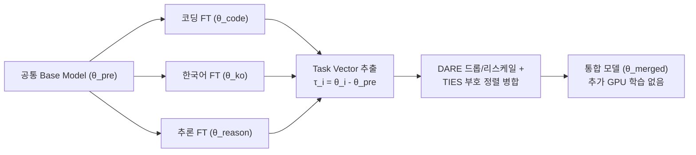

# Model Merging (모델 병합)

## 개요

**Model Merging**은 추가 GPU 학습이나 학습 데이터 없이, 동일한 사전학습 기반(base model)에서 파인튜닝된 여러 모델의 **가중치(또는 LoRA 어댑터)를 파라미터 공간에서 수학적으로 결합**해 다중 도메인 능력과 일반화 성능을 동시에 얻는 기법이다. 오픈웨이트 생태계에서 코딩·수학·지시 따르기 등 특화 모델을 조합해 맞춤형 모델을 빠르게 제작할 때 핵심 도구로 쓰인다.

## 왜 작동하는가: 손실 지형(Loss Basin) 공유

서로 다른 랜덤 시드에서 독립적으로 사전학습된 두 모델의 가중치를 단순 평균하면 성능이 파괴된다. 반면 **동일한 Base Model $\theta_{\text{pre}}$에서 출발해 파인튜닝된 모델들**($\theta_1, \theta_2, \dots$)은 가중치 공간의 같은 평탄한 저손실 분지(basin) 주변에 머무르는 경향이 있어, 선형·벡터 연산으로 결합해도 능력을 잃지 않고 시너지를 낼 수 있다 [1].

## 주요 병합 알고리즘

| 알고리즘 | 핵심 수식 / 원리 | 해결하는 문제 | 출처 |
|---|---|---|---|
| **Model Soups (Linear)** | $\theta = \sum w_i \theta_i$ | 동일 태스크 여러 체크포인트의 분산 감소 및 정확도 향상 | Wortsman et al. (ICML 2022) [1] |
| **SLERP** | 고차원 구면(Spherical) 선형 보간 | 단순 선형 평균 시 가중치 노름(norm) 축소 현상 방지 | Shoemake (1985) / MergeKit |
| **Task Arithmetic** | $\tau_t = \theta_t - \theta_{\text{pre}}$, $\theta = \theta_{\text{pre}} + \sum \lambda_t \tau_t$ | 태스크 벡터 덧셈으로 다중 능력 결합, 뺄셈($-\lambda \tau$)으로 특정 행동/편향 제거(Unlearning) | Ilharco et al. (ICLR 2023) [2] |
| **TIES-Merging** | **T**rim(하위 크기 절사) → **E**lect Sign(다수결 부호) → Di**s**joint Merge | 서로 다른 태스크 벡터 간 파라미터 부호 충돌 및 중복 간섭 해소 | Yadav et al. (NeurIPS 2023) [3] |
| **DARE** | 델타 파라미터($\tau_t$)의 90~99%를 무작위 드롭 후 $1/(1-p)$ 리스케일 | 극도의 희소화에도 성능 유지, TIES/Linear 병합 전처리로 간섭 최소화 | Yu et al. (ICML 2024) [4] |
| **Evolutionary Merge** | 가중치 조합·레이어별 스플라이싱(Passthrough) 레시피를 진화 알고리즘으로 탐색 | 수동 가중치 튜닝 한계 극복, 이종 도메인 조합 최적화 | Akiba et al. / Sakana AI (2024) [5] |



## 실무 구현: MergeKit

오픈소스 표준 도구인 `mergekit`은 CPU 환경에서도 레이어 단위로 스트리밍 병합을 수행할 수 있다:

```yaml
# mergekit YAML 설정 예시 (DARE-TIES 병합)
models:
  - model: Qwen/Qwen2.5-7B-Instruct
    # base_model 기준점
  - model: org/qwen2.5-7b-korean-ft
    parameters:
      density: 0.55   # DARE: 45% 파라미터 드롭
      weight: 0.5
  - model: org/qwen2.5-7b-code-ft
    parameters:
      density: 0.55
      weight: 0.5
merge_method: dare_ties
base_model: Qwen/Qwen2.5-7B-Instruct
parameters:
  normalize: true
dtype: bfloat16
```

## 경계 정리: 앙상블 · 증류 · Multi-LoRA와의 차이

| 접근법 | 추론 비용 (서빙 시) | 추가 학습 필요 | 적합한 상황 |
|---|---|---|---|
| **Model Merging** | **1× (단일 모델)** | 불필요 (CPU 수 분) | 동일 Base 파생 모델들의 능력을 단일 가중치로 영구 통합 |
| **Multi-LoRA 서빙** | ~1× (배치 내 동적 전환) | 어댑터별 학습 | 테넌트·태스크마다 독립 격리된 어댑터를 런타임에 선택 적용 |
| **Model Distillation** | 1× (소형 Student) | 필요 (고비용) | 아키텍처·크기가 다른 Teacher의 지식을 압축 |
| **Ensemble / Routing** | $K\times$ 또는 라우터 비용 | 불필요 | Base가 서로 다른 이종 모델들의 출력을 결합 |

## 한계 및 주의사항

- **동일 아키텍처·동일 조상 제약**: 서로 다른 아키텍처나 완전히 다른 사전학습 체크포인트 간에는 직접 병합이 어렵다(토크나이저·레이어 차원 불일치).
- **Task Interference**: 상호 충돌하는 지시 형식이나 안전 정렬을 가진 모델을 무리하게 병합하면 정렬이 약화되거나 출력이 퇴화할 수 있으므로 병합 후 반드시 벤치마크·안전 평가를 재실행해야 한다.

## AI Engineering에서의 역할

Model Merging은 **Zero-Training 모델 커스터마이징** 수단이다. 자체 데이터로 SFT/DPO를 돌려 만든 도메인 특화 모델과 오픈소스의 추론·코딩 특화 모델을 결합할 때, 전체 데이터셋을 섞어 재학습하는 비용 없이 몇 분 만에 후보 모델을 만들어 검증할 수 있게 한다.

## 관련 개념
[[AI/Engineering/Model_Engineering/Training_and_Tuning/Full_Fine-Tuning|Full_Fine-Tuning]] · [[AI/Engineering/Model_Engineering/Training_and_Tuning/PEFT_LoRA_QLoRA|PEFT_LoRA_QLoRA]] · [[AI/Engineering/Model_Engineering/Training_and_Tuning/Model_Distillation|Model_Distillation]] · [[AI/Engineering/Harness_Engineering/Harness_Evaluation/Benchmarking|Benchmarking]]

## 출처
- [1] Wortsman et al. (2022) "Model soups: averaging weights of multiple fine-tuned models improves accuracy without increasing inference time" — [arXiv:2203.05482](https://arxiv.org/abs/2203.05482)
- [2] Ilharco et al. (2023) "Editing Models with Task Arithmetic" — [arXiv:2212.04089](https://arxiv.org/abs/2212.04089)
- [3] Yadav et al. (2023) "TIES-Merging: Resolving Interference When Merging Models" — [arXiv:2306.01708](https://arxiv.org/abs/2306.01708)
- [4] Yu et al. (2024) "Language Models are Super Mario: Absorbing Abilities from Homologous Models as a Free Lunch (DARE)" — [arXiv:2311.03099](https://arxiv.org/abs/2311.03099)
- [5] Akiba et al. (2024) "Evolutionary Optimization of Model Merging Recipes" — [arXiv:2403.13187](https://arxiv.org/abs/2403.13187)
- Goddard et al. (2024) "Arcee's MergeKit: A Toolkit for Merging Large Language Models" — [arXiv:2403.13257](https://arxiv.org/abs/2403.13257)
