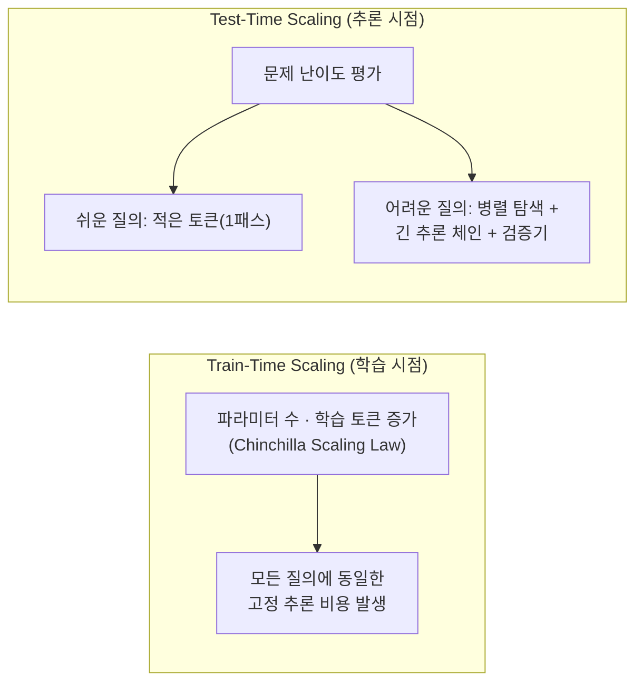

# Test-Time Compute Scaling (추론 시점 계산 스케일링)

## 개요

**Test-Time Compute Scaling**은 사전학습(Pre-training)이나 파인튜닝으로 모델 가중치를 키우는 대신, **추론 시점(inference time)에 더 많은 연산 예산(토큰 수·후보 샘플 수·탐색 깊이)을 배분**하여 복잡한 문제의 정답률을 높이는 패러다임이다. Snell et al.(2024)이 특정 난이도 구간에서는 모델 파라미터를 14배 키우는 것보다 추론 시점 계산량을 늘리는 편이 더 효율적임을 보이면서, 단순 CoT 프롬프팅을 넘어선 독립적인 설계 축으로 자리잡았다 [1].

## Train-Time vs Test-Time Scaling

## 3대 스케일링 축

### 1. Parallel Scaling (병렬 샘플링과 검증)
동일 프롬프트에서 $N$개의 독립적인 추론 경로를 병렬 생성한 뒤 최적의 답을 고른다.
- **Majority Voting (Self-Consistency)**: 가장 많이 등장한 최종 답을 선택한다(수학·객관식 등 답이 정규화되는 태스크에 적합).
- **Best-of-N with Verifier**: 별도의 보상 모델(ORM/PRM) 또는 실행 기반 검증기(단위 테스트, 컴파일러)로 $N$개 후보를 채점해 최고 점수 후보를 반환한다.

### 2. Sequential Scaling (순차 추론 연장과 자기 수정)
이전 시도의 중간 추론·실패 피드백을 이어받아 같은 스레드 안에서 추론을 깊게 전개한다.
- **Iterative Revision**: 초안 생성 → 오류 점검 → 수정 단계를 순차 반복한다.
- **Budget Forcing (`s1`)**: Muennighoff et al.(2025)이 제안한 단순 제어 기법으로, 모델이 추론 종료 토큰을 내려고 할 때 `"Wait"` 같은 이어쓰기 토큰을 강제 주입해 사고를 연장하거나, 예산 한도에 도달하면 종료 구분자를 강제 삽입해 답을 출력시킨다 [2].

### 3. Search with Verifiers (검증기 기반 트리 탐색)
병렬과 순차를 결합하여 중간 단계마다 유망한 가지를 남기고 실패한 가지를 조기에 가지치기한다.
- **Step-level Beam Search / Lookahead Search**: 각 추론 스텝마다 여러 다음 스텝 후보를 생성하고, **PRM(Process Reward Model)** 점수가 높은 상위 $B$개 경로만 유지해 끝까지 탐색한다 [1].

## ORM vs PRM (보상 모델 설계)

| 구분 | ORM (Outcome Reward Model) | PRM (Process Reward Model) |
|---|---|---|
| **채점 대상** | 최종 답변의 정오만 평가 | **중간 추론 단계마다** 논리적 타당성 채점 |
| **장점** | 정답 라벨만으로 학습 가능(데이터 구축 용이) | 잘못된 중간 단계를 조기에 차단, 탐색 효율 우수 |
| **한계** | 우연히 답만 맞힌 잘못된 추론 과정에 보상 부여 | 단계별 라벨링 비용이 높고 보상 해킹(Reward Hacking) 위험 |
| **대표 연구** | Cobbe et al. (GSM8K Verifier) | Lightman et al. (2023) "Let's Verify Step by Step" [3] |

## Compute-Optimal 배분과 Overthinking

추론 예산을 무조건 늘린다고 성능이 비례해 오르지는 않는다.
- **난이도별 최적 전략**: 매우 쉬운 문제에 긴 추론이나 대규모 Beam Search를 쓰면 비용만 폭증하고 오히려 정답을 뒤집어 오답을 내는 **Overthinking** 현상이 발생한다. 반대로 매우 어려운 문제는 단일 긴 추론보다 검증기 기반 탐색이나 병렬 샘플링이 유리하다.
- **실무 패턴**: 입력 질의의 난이도를 사전 분류해 `reasoning_effort` / `thinking_budget`과 Best-of-N의 $N$ 값을 동적으로 조절하는 **Compute-Optimal 라우팅**을 적용한다.

## 경계 정리

| 문서 | 다루는 것 |
|---|---|
| **본 문서 (Test_Time_Compute_Scaling)** | 추론 시점 연산 예산의 **배분 축(Parallel/Sequential/Search)**, ORM/PRM 검증기, Compute-Optimal 전략 |
| [[AI/Engineering/Prompt_Engineering/Chain_of_Thought\|Chain_of_Thought]] | CoT/ToT 프롬프팅 기법 자체와 reasoning 모델의 `thinking_budget` API 개요 |
| [[AI/Engineering/Loop_Engineering/Continuous_Optimization\|Continuous_Optimization]] | RLVR(GRPO) 등 **학습 시점** 최적화와 운영 루프 |
| [[AI/Engineering/Loop_Engineering/Cost_Engineering/Complexity_Aware_Model_Routing\|Complexity_Aware_Model_Routing]] | 요청 난이도에 따른 **모델 크기·예산** 라우팅 구현 |

## AI Engineering에서의 역할

Test-Time Compute Scaling은 "모든 요청에 최고가 대형 모델을 1회 호출한다"는 기존 설계를 넘어, **질의 난이도에 비례해 추론 토큰과 검증 연산을 동적으로 투자**하는 아키텍처를 가능하게 한다. 특히 코드 생성(단위 테스트 검증기 결합)과 수학·논리 추론, 복잡한 계획 수립에서 비용 대비 성능을 극대화하는 핵심 레버다.

## 관련 개념
[[AI/Engineering/Prompt_Engineering/Chain_of_Thought|Chain_of_Thought]] · [[AI/Engineering/Prompt_Engineering/Sampling_Controls|Sampling_Controls]] · [[AI/Engineering/Loop_Engineering/Continuous_Optimization|Continuous_Optimization]] · [[AI/Engineering/Loop_Engineering/Cost_Engineering/Complexity_Aware_Model_Routing|Complexity_Aware_Model_Routing]] · [[AI/Engineering/Model_Engineering/Training_and_Tuning/Full_Fine-Tuning|Full_Fine-Tuning]]

## 출처
- [1] Snell et al. (2024) "Scaling LLM Test-Time Compute Optimally can be More Effective than Scaling Model Parameters" — [arXiv:2408.03314](https://arxiv.org/abs/2408.03314)
- [2] Muennighoff et al. (2025) "s1: Simple test-time scaling" — [arXiv:2501.19393](https://arxiv.org/abs/2501.19393)
- [3] Lightman et al. (2023) "Let's Verify Step by Step" — [arXiv:2305.20050](https://arxiv.org/abs/2305.20050)
