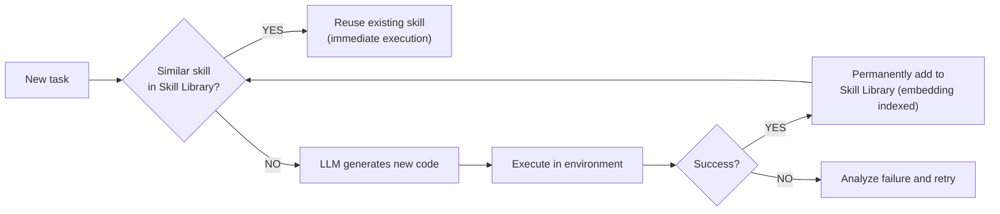
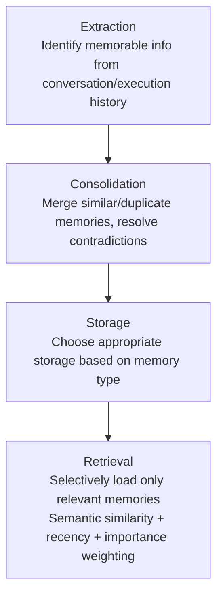

# Agent Memory

## Overview

**Agent Memory** is a lifecycle for extracting, validating, storing, updating, and deleting information gained during execution and using it for subsequent actions. The concepts of storage location and scope are covered in [[en/AI/Engineering/Context_Engineering/LLM_Memory|LLM_Memory]], and this document focuses on operational policies and failure handling.

The SDK snippet below is for demonstration purposes and is not a standalone program. Parts requiring provider and storage configuration and authentication must be prepared in the application. Storing long-term memory does not mean the model weights are being trained.

## Short-term Memory

### Conversation History
Current session conversation content stored in the LLM's context window:

```python
from langchain_core.messages import HumanMessage, AIMessage

# Conversation history accumulates
messages = [
    HumanMessage(content="Hi! My name is Alice"),
    AIMessage(content="Hello, Alice!"),
    HumanMessage(content="Do you remember my name?"),
    # LLM references this entire history and answers "Alice"
]
```

### In-Context Working Memory
Storing intermediate results during complex task execution:
```python
from typing import TypedDict

class AgentState(TypedDict):
    task: str
    plan: list[str]
    completed_steps: list[dict]   # results of completed steps
    tool_outputs: list # tool outputs
    current_hypothesis: str       # current working hypothesis
```

### Limitations of Short-Term Memory
- Old content needs to be deleted when the context window is exceeded
- If there is no persistent checkpoint, recovery is impossible after process termination
- Solution: Conversation summarization + transfer to Long-term

In LangChain v1, the thread is maintained using Agent state and checkpointer, and the context is managed by trim or summarization middleware. Summarization also incurs model calling costs, and the omission of the original text must be evaluated. See [[en/AI/Engineering/Flow_Engineering/Linear_Flow/LangChain|LangChain]] for execution configuration.

## Long-term Memory

External storage-based memory that persists across sessions.

### Vector-based Memory
Retrieving related memories via semantic search:

The search implementation is composed of clients for each Vector DB. Upon saving, a memory ID is returned, and read, modify, and delete operations are restricted to the authenticated `(tenant_id, user_id)` scope. The user ID generated by the model is not used as the access permission. If the embedding index update fails after successful DB storage, a retryable event is left.

### User Profile Memory
Storing user characteristics and preferences in a structured format:

```python
from pydantic import BaseModel, Field
from typing import Optional

class UserProfile(BaseModel):
    user_id: str
    name: Optional[str] = None
    preferred_language: str = "ko"
    expertise_level: str = "intermediate"  # beginner/intermediate/expert
    interests: list[str] = Field(default_factory=list)
    communication_style: str = "formal"    # formal/casual
    
class ProfileMemory:
    def update_from_conversation(self, profile: UserProfile, message: str):
        """Update the profile from the conversation."""
        update_prompt = f"""
        Current user profile: {profile.model_dump()}
        New conversation content: {message}
        
        Return the items that need profile updates as JSON.
        Return empty object {{}} if no changes.
        """
        updates = llm_json_output(update_prompt)
        allowed = {"preferred_language", "interests", "communication_style"}
        safe_updates = {k: v for k, v in updates.items() if k in allowed}
        return UserProfile.model_validate({**profile.model_dump(), **safe_updates})
```

### Episodic Memory
Records of past task executions:

```python
# Store successful task patterns
episodic_memory.save({
    "task_type": "code debugging",
    "problem": "IndexError in list comprehension",
    "solution_steps": ["Check index range", "Validate with len()", "Add try-except"],
    "success": True,
    "time_taken": 120
})

# Retrieve for similar tasks
similar_cases = episodic_memory.search("array index error")
```

## Memory as a Tool Pattern

Registering memory as one of the agent's tools:

```python
from langchain.tools import tool
from langchain.agents import create_agent

@tool
def remember(content: str) -> str:
    """Store important information in long-term memory."""
    memory_store.save(content)
    return f"Memory saved: {content[:50]}..."

@tool
def recall(query: str) -> str:
    """Search for related memories."""
    memories = memory_store.search(query)
    return "\n".join([m.page_content for m in memories])

# Agent decides to save/retrieve memory
agent = create_agent(model=llm, tools=[remember, recall])
```

## MemGPT / Virtual Context Management

Architecture proposed by Packer et al. (2023, MemGPT paper, later renamed Letta). Directly applies the OS **Virtual Memory** concept to LLMs — treating the limited context window as physical memory (RAM) and external storage as disk.

```
OS virtual memory analogy:
  RAM (limited, fast)        ↔ Main Context (LLM context window)
  Disk (almost unlimited)    ↔ External Context (external DB)
  Page Fault (load on need)  ↔ Explicit memory fetch/store via function calls

MemGPT Main Context structure:
  ┌─────────────────────────────┐
  │ System Instructions (fixed) │
  │ Working Context (key summary)│ ← LLM can self-edit
  │ FIFO Queue (recent dialogue) │ ← When full, summarize oldest then evict
  └─────────────────────────────┘
```

Core idea: **the LLM itself calls functions to manage its own memory** — using tools like `core_memory_append()` and `archival_memory_search()` to actively decide what to keep and what to evict.

## Sleep-Time Compute

Concept proposed by the Letta team (2025). Agents use **idle time** (waiting for user requests) to organize and restructure memory in the background — similar to how humans consolidate memories during sleep.

```
Traditional approach: search and organize all memories in real-time on every request → increased latency

Sleep-time Compute:
  During idle time, proactively:
    - Summarize and structure conversation logs
    - Detect and resolve contradictory memories
    - Pre-compute and cache answers for frequent queries
  → At actual request time, only pre-organized memory is queried (reduced latency)
```

**Effect**: Reduces response-time latency and token cost while maintaining memory quality (contradiction resolution, freshness). The philosophy is similar to the caching strategies of Runtime Optimization ([[en/AI/Engineering/Loop_Engineering/Runtime_Optimization|Loop_Engineering/Runtime_Optimization]]), but the target is memory state rather than the response itself.

## Mem0 — Fact Extraction and Update

The Mem0 paper (2025) describes a structure for extracting relevant facts from conversations and storing and updating them by comparing them with existing memories. Graph expansion is an optional choice to augment relational representations, and it is not assumed that all basic installations simultaneously use Vector, Graph, and KV.

Evaluation results depend on the dataset, judge, baseline, and retrieval budget. Do not interpret specific benchmark scores as general personalization accuracy, but rather reproduce them on your own data. The functionality of passing user-specific IDs and server-side access control are separate responsibilities.

## Skill Libraries and Lifelong Learning — Voyager

Lifelong learning agent proposed by Wang et al. (2023) in a Minecraft environment. Core idea: agents **store successful actions as reusable code skills in a library**, and for similar problems later, search the library and reuse rather than reasoning from scratch.



## LangMem and Processing Time

LangMem provides tools for memory extraction/integration, management, and retrieval. The official API includes `create_manage_memory_tool`, `create_search_memory_tool`, etc., and is used to configure stores and namespaces. We compare the installed version before applying the API snippets with the official reference.

- **Hot path:** Synchronously processes updates that are essential for the current response. Handling latency increase and storage failure is necessary.
- **Background:** Extracts and integrates after the conversation. While this moves the cost outside the response path, it requires handling the delay until new facts are visible and duplicate events.
- Write, Select, and Compress are perspectives explaining the implementation and are not attributed to a specific researcher as a "standard three-bucket classification."

## Memory ETL Pipeline

Memory needs processing stages like an **ETL pipeline**, not just storage and retrieval:



### Provenance (Source Tracking)

Managing memory reliability and validity:

```python
class MemoryWithProvenance:
    content: str
    source: str          # from which conversation/task it was extracted
    created_at: datetime
    confidence: float    # extraction confidence (0.0~1.0)
    last_verified: datetime  # when last confirmed
    
    def is_stale(self, days_threshold: int = 30) -> bool:
        return (datetime.now() - self.last_verified).days > days_threshold
```

## Collision, Deletion, and Isolation Policies

| Stage | Operating Policy | Failure Cases to Verify |
|---|---|---|
| Extraction | Source ID and timestamp of user utterances and tool results | Saving model estimations as user facts |
| Update | Distinguishing between observation time and fact validity time; reflecting explicit corrections | Late-arriving past events overwriting the latest values |
| Integration | Preventing duplicate processing of the same event; maintaining provenance for collisions | Merging facts from different people into one profile |
| Query | Filtering by tenant, user, ACL, and validity period | Omitting permission verification after similarity search |
| Deletion | Tracking deletion propagation across the original, index, summary, and cache | Deleted facts being regenerated in summary or background jobs |
| Reprocessing | Writing after checking version or tombstone | Old retries reversing deletions |

TTL expiration and user deletion requests are distinguished. The backup retention policy is also defined, and the scope for declaring deletion completion is clarified. Only allowed fields are reflected and validated during profile updates. `model_copy(update=...)` alone does not replace the validation of untrustworthy updated values.

## Evaluation and Selection Criteria

We divide tasks into those requiring memory and those that do not to establish a baseline. We measure storage accuracy, relevant memory recall, response after correction, re-exposure after deletion, cross-user leakage, extraction/retrieval cost, and p95 latency. If there are conflicting grounds, instead of confirming with the latest timestamp alone, we check the source and validity period or confirm with the user.

Even when using a Managed Memory Bank, we check retention, access control, and consistency conditions. Resumption after runtime interruption and long-term user memory are different functionalities, and infrastructure selection is covered in [[en/AI/Engineering/Agent_Engineering/Agent_Infrastructure/Agent_Deployment|Agent_Deployment]].

## Role in AI Engineering

Agent Memory is the core element that transforms an agent from a "one-time tool" into a "continuously learning assistant." It is the foundation for personalized AI experiences, such as building long-term relationships with users, accumulating organizational know-how, and preventing repeated mistakes. In production, the Memory ETL pipeline manages the quality of memory, while persistent storage, access policies, and deletion propagation verification support session recovery and long-term operation.

## Related Concepts
[[en/AI/Engineering/Agent_Engineering/Agent_Core_Pillars|Agent Core Pillars]] · [[en/AI/Engineering/Context_Engineering/LLM_Memory|LLM Memory]] · [[en/AI/Engineering/Context_Engineering/Semantic_Cache|Semantic Cache]] · [[en/AI/Engineering/Context_Engineering/Context_Engineering|Context Engineering]] · [[en/AI/Engineering/Context_Engineering/Agentic_Context_Management|Agentic Context Management]] · [[en/AI/Engineering/Agent_Engineering/Agent_Techniques/Planning_and_Reflection|Planning & Reflection]] · [[en/AI/Engineering/Agent_Engineering/Agent_Techniques/Agent_Skills_and_Protocols|Agent Skills & Protocols]] · [[en/AI/Engineering/Agent_Engineering/Agent_Infrastructure/Agent_Deployment|Agent Deployment]]

## Sources
- Weng, L. (2023) "LLM Powered Autonomous Agents" — [lilianweng.github.io](https://lilianweng.github.io/posts/2023-06-23-agent/)
- Packer et al. (2023) "MemGPT: Towards LLMs as Operating Systems" — [arXiv:2310.08560](https://arxiv.org/abs/2310.08560)
- Letta (formerly MemGPT) "Sleep-time Compute" — [letta.com/blog](https://www.letta.com/blog/sleep-time-compute)
- Mem0 "Building Production-Ready AI Agents with Scalable Long-Term Memory" — [arXiv:2504.19413](https://arxiv.org/abs/2504.19413) · [mem0.ai](https://mem0.ai)
- Wang et al. (2023) "Voyager: An Open-Ended Embodied Agent with Large Language Models" — [arXiv:2305.16291](https://arxiv.org/abs/2305.16291)
- [[en/AI/sources/Context_Engineering_Sessions_&_Memory|Context Engineering Sessions & Memory]] (Existing source for this wiki, first published Nov 2025 → updated May 2026)
- LangMem documentation — [langchain-ai.github.io/langmem](https://langchain-ai.github.io/langmem/)
- AI Engineering from Scratch, Phase 14 · Lessons 07-10 (MemGPT, Sleep-time Compute, Mem0, Voyager) — [GitHub](https://github.com/rohitg00/ai-engineering-from-scratch/tree/main/phases/14-agent-engineering)

- LangChain, [Short-term memory](https://docs.langchain.com/oss/python/langchain/short-term-memory)
- Pydantic, [Models](https://docs.pydantic.dev/latest/concepts/models/)
