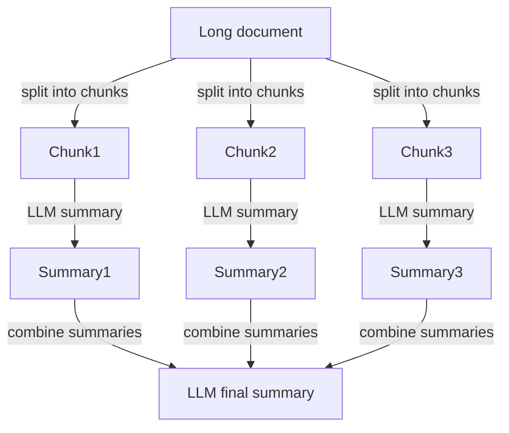

# Context Compression / Prompt Pruning

## Overview

**Context Compression** is a technique that minimizes information entering the LLM's context window while retaining necessary information. **Prompt Pruning** is the specific implementation of removing unnecessary content from prompts. It is a key optimization for reducing context window costs and latency.

## Why Is It Needed?

```
Cost structure (GPT-4 Turbo):
  Input tokens: $0.01 / 1K tokens
  Output tokens: $0.03 / 1K tokens

Filling the 128K context window:
  = 128K × $0.01 = $1.28/request
  10,000 requests/day = $12,800/day

Removing 50% unnecessary context:
  = $6,400/day savings
```

## Key Techniques

### 1. LLM Lingua (Selective Compression)

Token-level compression developed by Microsoft Research (2023):

```python
from llmlingua import PromptCompressor

compressor = PromptCompressor(
    model_name="microsoft/llmlingua-2-xlm-roberta-large-meetingbank",
    device_map="cuda"
)

compressed = compressor.compress_prompt(
    context,
    instruction="Answer the question",
    question="How do you sort in Python?",
    target_token=200,        # target token count
    rate=0.55,               # compression rate (remove 45%)
    condition_in_question="after_condition"
)

print(compressed["compressed_prompt"])  # Prompt with unnecessary tokens removed
```

**How it works**: A small language model calculates an importance score for each token; low-score tokens are removed.

### 2. Extractive Filtering (Chunk-Level Relevance Extraction)

Extract only sentences relevant to the query from retrieved RAG chunks rather than passing whole chunks:

```python
from langchain_openai import ChatOpenAI

llm = ChatOpenAI(model="gpt-4o-mini", temperature=0)
compressed_docs = [
    llm.invoke(
        f"Extract only the sentences relevant to the query.\nQuery: {query}\nDocument: {doc.page_content}"
    ).content
    for doc in vectorstore.as_retriever().invoke(query)
]
```

### 3. Map-Reduce Summarization (Long Documents)

When it's difficult to process the entire document at once:


### 4. Conversation History Trimming & Summarization

Save tokens in multi-turn conversations by trimming old turns with `trim_messages` or summarizing previous dialogue:

```python
from langchain_core.messages import trim_messages
from langchain_openai import ChatOpenAI

llm = ChatOpenAI(model="gpt-4o-mini")
trimmed_messages = trim_messages(
    messages,
    max_tokens=500,
    strategy="last",
    token_counter=llm,
    include_system=True,
)
```

In agent loops this generalizes to **Compaction**, which summarizes automatically near the context limit → [[en/AI/Engineering/Context_Engineering/Agentic_Context_Management|Agentic Context Management]].

### 5. Selective Context

Don't always include all tool descriptions and few-shot examples; dynamically select only what's needed:
```python
# Include only query-relevant tools
def select_relevant_tools(query: str, all_tools: list) -> list:
    query_embed = embed(query)
    tool_embeds = [embed(tool.description) for tool in all_tools]
    similarities = cosine_sim(query_embed, tool_embeds)
    return [all_tools[i] for i in top_k_indices(similarities, k=3)]
```

## Compression Technique Comparison

| Technique | Compression rate | Quality loss | Speed | Suitable case |
|------|-------|---------|------|-----------|
| LLM Lingua | 50~80% | Low | Fast | RAG context |
| LLM Summarization | 70~90% | Medium | Slow | Long document processing |
| Contextual Compression | 40~60% | Low | Medium | RAG chunks |
| Conv. Summary Memory | 60~80% | Low | Slow | Long conversation sessions |

## Lost in the Middle Problem

Information in the middle of the context window is used less than information at the ends (Liu et al., 2023). Compression eases this by removing unneeded middle content; see [[en/AI/Engineering/Context_Engineering/Lost_in_the_Middle|Lost in the Middle]] for causes and placement strategies.

## Role in AI Engineering

Context Compression simultaneously achieves both **cost optimization** and **performance improvement**. Removing unnecessary tokens reduces API costs, and concentrating on core information improves model response quality. It is especially the key technique for managing accumulated context in Agent systems with long context windows.

## Related Concepts
[[en/AI/Engineering/Context_Engineering/Retrieval_Strategies/RAG/Chunking_Strategies|Chunking Strategies]] · [[en/AI/Engineering/Context_Engineering/Retrieval_Strategies/RAG/Advanced_Retrieval|Advanced Retrieval]] · [[en/AI/Engineering/Context_Engineering/LLM_Memory|LLM Memory]] · [[en/AI/Engineering/Context_Engineering/Semantic_Cache|Semantic Cache]] · [[en/AI/Engineering/Context_Engineering/Agentic_Context_Management|Agentic Context Management]] · [[en/AI/Engineering/Loop_Engineering/Runtime_Optimization|Runtime Optimization]]

## Sources
- Jiang et al. (2023) "LLMLingua: Compressing Prompts for Accelerated Inference" — [arXiv:2310.05736](https://arxiv.org/abs/2310.05736)
- Liu et al. (2023) "Lost in the Middle: How Language Models Use Long Contexts" — [arXiv:2307.03172](https://arxiv.org/abs/2307.03172)
- LangChain "Contextual Compression" — [python.langchain.com](https://python.langchain.com/docs/how_to/contextual_compression/)
