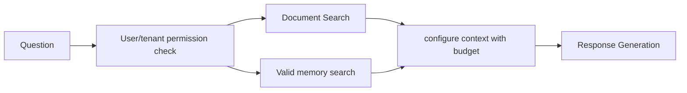

# LLM Memory

## Overview

**LLM Memory** is a mechanism that stores and retrieves knowledge from previous interactions to provide it for subsequent reasoning. The model call itself does not automatically remember previous requests. The continuity is determined by what state the application preserves and what content it puts into the next context.

## Storage Location and Persistence

The four perspectives below provide a comprehensive explanation for comparing storage location and computation reuse. These perspectives are a synthesis, not a standard four-way taxonomy attributed to Lilian Weng (2023). Weng's Agent overview distinguishes between short-term memory in-context and long-term memory using external storage.

| Perspective | Contents | Persistence and Limitations |
|---|---|---|
| **In-Context** | Messages and search results read by the model in the current request | Limited by the context window; can be reloaded if the original storage is separate |
| **External** | Conversation, facts, user profile, task history | Persistent depending on the storage policy (DB, file, etc.); requires retrieval quality and access control |
| **In-Weights** | Patterns and knowledge reflected in parameters through training | Not updated by general inference; does not guarantee accurate lookup or deletion of individual facts |
| **In-Cache** | Reusable computational states such as attention KV | Depends on runtime, prefix, TTL, and eviction conditions; is not a substitute for user memory storage |

The KV Cache does not add separate semantic knowledge. The implementation of the computational state refers to [[en/AI/Engineering/Loop_Engineering/Serving_Engineering/Inference_Internals|Inference_Internals]], and prefix reuse at the API level refers to [[en/AI/Engineering/Prompt_Engineering/Prompt_Caching|Prompt_Caching]]. Since the provider can support cache reuse across requests, it is not generalized as "valid only within the same session."

## Scope and Lifespan are Different Axes

| Scope | Example | Policies to Check |
|---|---|---|
| Thread / Session | Current conversation and ongoing task | thread ownership, checkpoint retention period |
| User | User preferences and explicit facts | isolation between users, correction/deletion requests |
| Agent / Application | Reusable procedures and business rules | version, permission, review responsibility |
| Organization | Team common knowledge | tenant/role-based access control |

Short-term can refer to the scope of use and does not necessarily mean it is lost upon process termination. If a persistent checkpointer is available, the thread can be restored. Conversely, even if named long-term, if only an in-memory store is used, it will disappear after a restart.

## Memory Selection for Context

| Strategy | Suitable Situation | Failure Condition |
|---|---|---|
| Full history | Short conversations, importance of preserving original text | Increased token cost, context overflow |
| Recent window | Tasks focusing on recent events | Omission of old constraints; K turns does not necessarily mean fixed token count |
| Summary + Recent original text | Long conversations with limited budget | Loss of facts, negations, or figures during summarization |
| Structured profile | Explicit preferences and settings | Confirmation of incorrect extractions as facts |
| Retrieval | Large episodic/semantic repositories | Incorrect retrieval, outdated facts, permission leakage |

If the message is simply sliced, the tool call and the corresponding result can be separated. Even after selection and compression, the provider's message rules and essential system instructions must be maintained. Detailed context budget design is covered in [[en/AI/Engineering/Context_Engineering/Agentic_Context_Management|Agentic_Context_Management]].

## Boundaries of Implementation

LangChain v1 configures thread-level memory with Agent state and checkpointer. Examples using past `ConversationBufferMemory` series should be read along with the legacy version. Current Agent API examples refer to [[en/AI/Engineering/Flow_Engineering/Linear_Flow/LangChain|LangChain]].

Letta/MemGPT is an example of explicit movement between context and external memory, Mem0 is for fact extraction and updating, and Zep/Graphiti are cases to examine relational representations including temporal information. Regardless of which library you choose, persistence, tenant isolation, deletion propagation, and retrieval evaluation must be verified separately. SDK calls and operational lifecycle are covered in [[en/AI/Engineering/Agent_Engineering/Agent_Techniques/Agent_Memory|Agent_Memory]].

## Types of Memory Content

| Type | Example | Relationship with Storage Location |
|---|---|---|
| Episodic | Attempts and results of a specific task | Can be retrieved from external records and put into the context |
| Semantic | Facts and user preferences | Stored along with the source and validity period |
| Procedural | Verified work procedures and skills | Requires version and execution rights |
| Working | Current plans and intermediate results | Preserved in the state, but only necessary parts are provided to the model |

This classification describes the **content** of the memory. It does not correspond one-to-one with the storage location classification.

## Memory and RAG

RAG retrieves information and supplies it to generation, while Memory is a state management problem that includes what to retain, modify, or forget. RAG can also be used for memory retrieval. Since RAG can also support user-specific ACLs and real-time updates, the distinction of "static, read-only, same for all users" is not appropriate.

## Selection and Evaluation

For a service that answers single questions, document retrieval alone may be sufficient without long-term personal memory. Tasks that require maintaining previous decisions necessitate checkpoints, and personalization across multiple threads requires a memory store per user.

Evaluation includes not only memory recall but also the rate of incorrectly stored facts, updating changed facts, excluding old memories, re-exposure after deletion, and contamination from other users' information. We do not assume that quality improves simply by increasing search volume.

## Role in AI Engineering

LLM Memory connects stored states with the context required for current inference. It is important to select valid information with the correct permissions at the necessary time, rather than just the amount of memory.

## Related Concepts
[[en/AI/Engineering/Context_Engineering/Semantic_Cache|Semantic Cache]] · [[en/AI/Engineering/Context_Engineering/Context_Engineering|Context Engineering]] · [[en/AI/Engineering/Context_Engineering/Agentic_Context_Management|Agentic Context Management]] · [[en/AI/Engineering/Agent_Engineering/Agent_Techniques/Agent_Memory|Agent Memory]] · [[en/AI/Engineering/Context_Engineering/Retrieval_Strategies/RAG/RAG|RAG]]

## References
- Weng, L. (2023), [LLM Powered Autonomous Agents](https://lilianweng.github.io/posts/2023-06-23-agent/)
- LangChain, [Short-term memory](https://docs.langchain.com/oss/python/langchain/short-term-memory)
- Packer et al. (2023), [MemGPT](https://arxiv.org/abs/2310.08560)
- Chhikara et al. (2025), [Mem0](https://arxiv.org/abs/2504.19413)
- Rasmussen et al. (2025), [Zep](https://arxiv.org/abs/2501.13956)
