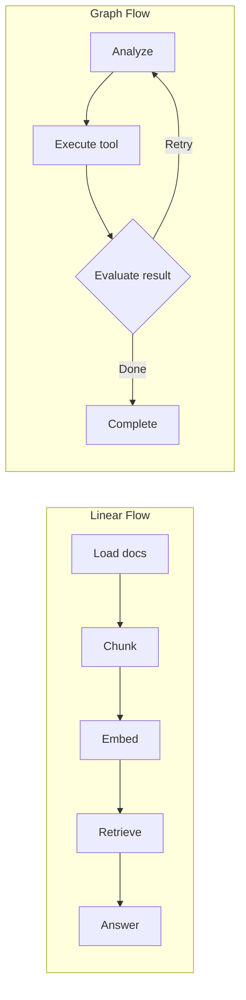
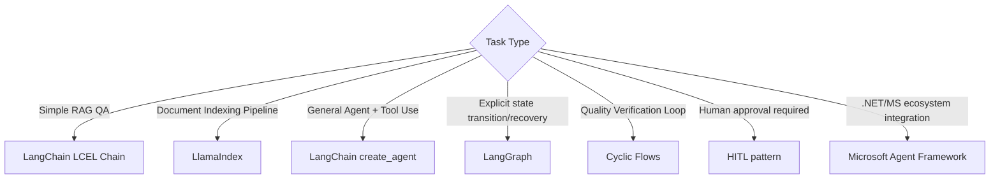

# Flow Engineering

## Overview

**Flow Engineering** is the architecture design skill of **connecting multiple LLM calls, tool executions, and data transformations into a pipeline** to complete complex tasks. It answers "how to compose things that a single LLM call cannot solve."

## Two Flow Types

## Sub-documents

| Document | Content |
|------|------|
| [[en/AI/Engineering/Flow_Engineering/Linear_Flow/Linear_Flow\|Linear Flow]] | Sequential Pipeline Overview |
| [[en/AI/Engineering/Flow_Engineering/Linear_Flow/LangChain\|Linear_Flow/LangChain]] | LCEL, v1 create_agent·Middleware, legacy API Distinction |
| [[en/AI/Engineering/Flow_Engineering/Linear_Flow/LlamaIndex\|Linear_Flow/LlamaIndex]] | Indexing-Query Pipeline (Jerry Liu, 2022) |
| [[en/AI/Engineering/Flow_Engineering/Linear_Flow/Tool_Use_and_Function_Calling\|Linear_Flow/Tool_Use_and_Function_Calling]] | Tool Calling·Result Contract, Authorization Verification, Retry·Idempotency |
| [[en/AI/Engineering/Flow_Engineering/Graph_Flow/Graph_Flow\|Graph Flow]] | Cyclic Graph Flow Overview |
| [[en/AI/Engineering/Flow_Engineering/Graph_Flow/LangGraph\|Graph_Flow/LangGraph]] | StateGraph, Conditional Termination, Checkpoint·Resumption, and Side Effects |
| [[en/AI/Engineering/Flow_Engineering/Graph_Flow/Cyclic_Flows\|Graph_Flow/Cyclic_Flows]] | Evaluate-and-Retry, Self-Correction |
| [[en/AI/Engineering/Flow_Engineering/Graph_Flow/ReAct_Pattern\|Graph_Flow/ReAct_Pattern]] | Thought-Action-Observation (Yao, 2022) |
| [[en/AI/Engineering/Flow_Engineering/Graph_Flow/Human_in_the_Loop\|Graph_Flow/Human_in_the_Loop]] | Human Intervention Points — Breakpoints, Time Travel |

## Technical Selection Criteria

**Microsoft Agent Framework 1.0** (2026-04-03 GA) integrates **Semantic Kernel** (enterprise state management · type safety) and **AutoGen** (multi-agent orchestration), which were previously separate, into a single .NET+Python SDK — natively supporting MCP and A2A from 1.0. AutoGen and Semantic Kernel have been moved to maintenance mode. It is considered an alternative to LangGraph for .NET/Azure-centric organizations. See [[en/AI/Engineering/Agent_Engineering/Agent_Infrastructure/Agent_Frameworks|Agent_Engineering/Agent_Frameworks]] for a detailed comparison of the frameworks.

## Role in AI Engineering

Flow Engineering is the **layer that solves tasks impossible for a single LLM call by building a system around it**. It overcomes the limitations of single model calls (context length, step-by-step reasoning) through pipelines, and serves as the direct foundation for Agent Engineering.

## Related Concepts
[[en/AI/Engineering/Context_Engineering/Context_Engineering|Context Engineering]] · [[en/AI/Engineering/Agent_Engineering/Agent_Engineering|Agent Engineering]]
