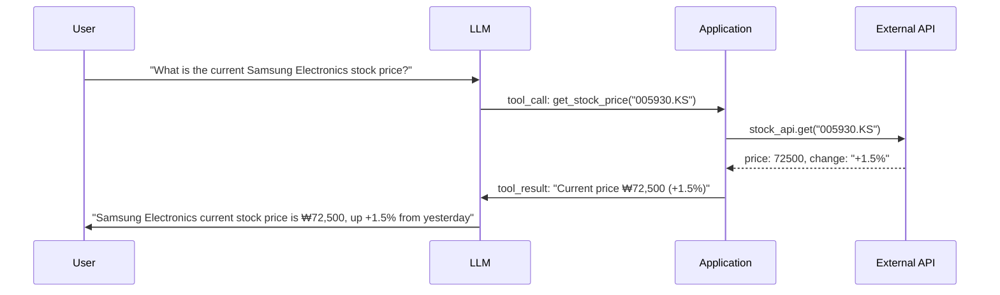

# Tool Use & Function Calling

## Overview

**Tool Use** (or Function Calling) is the ability of LLMs to call external functions, APIs, and tools to go beyond their knowledge limitations. When the LLM outputs "what tool to call with what arguments" in a structured form, the application handles actual execution and provides the results back to the LLM.

The additional framework and MCP snippets below are pseudocode showing component relationships. The application supplies any storage, tool, and authentication objects not shown.

## Origin and History

- **OpenAI Function Calling** (June 2023): Function Calling API announcement
- **Anthropic Tool Use** (early 2024): Official Claude support
- **Google Function Declarations**: Gemini support
- **MCP (Model Context Protocol)**: Open tool standard proposed by Anthropic (2024) → [[en/AI/Engineering/Agent_Engineering/Agent_Techniques/Agent_Skills_and_Protocols/MCP|MCP]]

## How It Works



## API Implementation Examples

This **illustrative Responses API example** uses Python 3.12 and OpenAI Python SDK 2.54.0. It requires `OPENAI_API_KEY` and an `OPENAI_MODEL` that supports Function Calling. Do not mix the nested `function` object in Chat Completions with the flat tool definition in Responses. No live API call was made; SDK request shape and tool-result delivery were verified with mocks.

```python
import json
import os
from openai import OpenAI

client = OpenAI()
tools = [{
    "type": "function",
    "name": "get_weather",
    "description": "Return demo weather data for Seoul in Celsius.",
    "strict": True,
    "parameters": {
        "type": "object",
        "properties": {"city": {"type": "string", "enum": ["Seoul"]}},
        "required": ["city"],
        "additionalProperties": False,
    },
}]

def execute_call(call):
    if call.name != "get_weather":
        return {"error": "unknown_tool"}
    try:
        args = json.loads(call.arguments)
    except (json.JSONDecodeError, TypeError):
        return {"error": "invalid_arguments"}
    if not isinstance(args, dict) or args != {"city": "Seoul"}:
        return {"error": "invalid_arguments"}
    # Fixed fixture, not a response from an external weather API
    return {"city": "Seoul", "temperature_c": 20, "source": "demo_fixture"}

history = [{"role": "user", "content": "Use the demo tool for Seoul weather."}]
for step in range(3):
    response = client.responses.create(
        model=os.environ["OPENAI_MODEL"], input=history, tools=tools,
    )
    if response.status != "completed":
        raise RuntimeError("Incomplete model turn")
    # Preserve all output items, including reasoning items, in the next input
    history.extend(response.output)
    calls = [item for item in response.output if item.type == "function_call"]
    if not calls:
        if not response.output_text:
            raise RuntimeError("No text output; inspect refusal or other output items")
        print(response.output_text)
        break
    for call in calls:
        history.append({
            "type": "function_call_output",
            "call_id": call.call_id,
            "output": json.dumps(execute_call(call)),
        })
else:
    raise RuntimeError("Tool loop budget exhausted")
```

`strict=True` enforces the argument schema. Specify `additionalProperties: false` and required fields for each object. Select executable function names from an allow-list; never execute model strings with `eval`. The example provides only a read-only fixture and does not verify live weather accuracy.

Anthropic Messages tool definitions use `name`, `description`, and `input_schema`. Process every `tool_use` block in the response content and return its corresponding ID as `tool_result.tool_use_id`. This differs from OpenAI's `call_id`; build adapters against the official documentation for each SDK and endpoint.

## Execution Contracts and Failure Handling

| Stage | Contract to verify | Failure handling |
|---|---|---|
| Tool selection | allow-list, supported tool version | Do not execute unknown tools |
| Argument validation | schema + business invariants | Distinguish format errors from business rejection |
| Authorization and approval | authenticated principal, resource ACL, required approval | Do not trust model-generated user IDs or approval text |
| Execution | timeout, retry budget, idempotency | Do not immediately repeat writes with uncertain outcomes |
| Result delivery | match every call ID to a result, size limits | Return structured errors; strip sensitive internal exceptions |

For writes, persist an application-generated operation ID, argument hash, processing status, and result. Reject reuse of an operation ID with different arguments. If the external service supports idempotency keys, reuse the same key when retrying the same business operation. Otherwise, verify the result through queries and reconciliation after a timeout; do not promise exactly-once execution without deduplication.

A model's tool call ID connects a request to its result within a conversation. A subsequent model call can generate a new ID, so it cannot replace a business-level idempotency key. Reassess approval scope when approved arguments change. Set an overall deadline and cost cap in addition to an iteration limit.

## Parallel Tool Calling

Some models can request multiple tool calls in one turn. The application decides whether to execute them concurrently. Execute dependent operations or conflicting writes sequentially, and apply concurrency and timeout limits even to independent reads:
```python
# LLM decides to call multiple tools simultaneously
tool_calls = [
    {"name": "get_weather", "args": {"city": "Seoul"}},
    {"name": "get_news", "args": {"topic": "stocks"}},
    {"name": "search_db", "args": {"query": "Samsung Electronics"}}
]
# Run three tools in parallel → collect all results → generate single response
```

## Tool Design Best Practices

```python
# ✅ Good tool description
{
    "name": "search_products",
    "description": "Search for products in the product database. "
                   "Can filter by product name, category, and price range.",
    "parameters": {
        "query": "Search term (e.g., 'Bluetooth earphones')",
        "category": "Category filter (e.g., 'Electronics'). Optional.",
        "max_price": "Maximum price in USD. Optional.",
        "limit": "Maximum number of results to return (default: 10)"
    }
}

# ❌ Bad tool description
{
    "name": "search",  # Too vague
    "description": "Searches",  # No information
    "parameters": {"q": "query"}  # No description
}
```

## Tool Type Classification

Tools used in Tool Use are classified into three types by **who defines them and how they are executed** [1].

### 1. Built-in Tools

Tools provided at the platform level by model service providers. Developers activate them with a single API parameter without separate implementation; they are tightly integrated with model training.

| Platform | Built-in tool examples |
|---------|----------------------|
| Gemini (Google) | Google Search Grounding, Code Execution, URL Context, Computer Use |
| OpenAI | Web Search, Code Interpreter, File Search |
| Claude (Anthropic) | Computer Use |

**Characteristics**: No implementation needed, platform-specific, high performance due to model integration.

### 2. Function Tools

Custom tools defined by developers in JSON Schema, where the LLM decides whether and with what arguments to call them, and the application code handles actual execution [1]. This is the core pattern described in "How It Works" and "API Implementation Examples" above.

```python
# Google ADK example: docstring is automatically converted to description
def set_light_values(brightness: int, color_temp: str):
    """Set living room light brightness and color temperature.

    Args:
        brightness: Brightness (0-100%)
        color_temp: Color temperature ("warm" | "cool")
    """
    ...
```

**Characteristics**: Fully customizable, platform-independent, can be standardized with MCP.

### 3. Agent Tools / Sub-Agent

A pattern that abstracts an entire other agent as a single tool [1]. An Orchestrator calls specialized Sub-Agents like functions, and remote agents can also be made into tools using the A2A (Agent-to-Agent) protocol.

```python
# Google ADK: wrap Sub-Agent as tool with AgentTool
from google.adk.tools import AgentTool

research_agent = LlmAgent(name="researcher", tools=[search_tool])
writer_agent = LlmAgent(
    name="writer",
    tools=[AgentTool(agent=research_agent)]  # Sub-Agent as a tool
)
```

**Characteristics**: Delegate complex tasks to specialized agents, recursive composition possible, separation of agent responsibilities.

→ See: [[en/AI/Engineering/Agent_Engineering/Agent_Architectures|Agent Architectures]] (Orchestrator & Sub-Agents pattern), [[en/AI/Engineering/Agent_Engineering/Agent_Techniques/Agent_Skills_and_Protocols/A2A|A2A]]

---

## Tool Use Cases by Function

Tools are classified into four categories by their role [1][2].

### 1. Information Retrieval

Tools that fetch data from external knowledge sources. Access latest information after LLM training cutoff or internal data.

- **Examples**: [[en/AI/Engineering/Agent_Engineering/Agent_Techniques/Agent_Skills_and_Protocols/MCP|MCP]] Toolbox, [[en/AI/Engineering/Context_Engineering/Retrieval_Strategies/NL2SQL/NL2SQL|NL2SQL]] (natural language → SQL), [[en/AI/Engineering/Context_Engineering/Retrieval_Strategies/RAG/RAG|RAG]] (vector DB search), [[en/AI/Engineering/Context_Engineering/Retrieval_Strategies/GraphRAG/Knowledge_Graph/Knowledge_Graph|Knowledge Graph]] queries
- **Characteristics**: Usually read-oriented, but query logs, costs, and data exposure remain possible; cache with authorization and freshness in mind

### 2. API Integration

Tools that call external service APIs to fetch real-time data or execute simple actions.

- **Examples**: Weather API, stock price API, payment API, GitHub REST API
- **Characteristics**: Real-time data access, authentication (API Key/OAuth) required, idempotency consideration

### 3. System Integration

Tools that connect to internal enterprise systems or SaaS services to perform actual actions.

- **Examples**: Gmail, Google Drive, Calendar, Slack, Jira, Salesforce (Google Connectors, etc.)
- **Characteristics**: Permanent side effects (email sending, file modification, etc.), fine-grained permission management essential, HITL review recommended

### 4. Human-in-the-Loop (HITL) ([[en/AI/Engineering/Flow_Engineering/Graph_Flow/Human_in_the_Loop|Human_in_the_Loop]])

Tools that request human approval/input at stages where agents cannot make autonomous judgments [1][2].

```python
def ask_for_confirmation(action: str, details: dict) -> bool:
    """Request human approval before irreversible actions"""
    # UI approval dialog → wait for user response
    return user_approved

def ask_for_input(prompt: str) -> str:
    """Request information from user that the agent cannot determine"""
    ...
```

- **When to use**: Irreversible operations (mass email sending, file deletion), sensitive data access, low model confidence
- **Characteristics**: Balance between autonomy and safety, can integrate with [[en/AI/Engineering/Agent_Engineering/Agent_Techniques/Agent_Skills_and_Protocols/MCP|MCP]] Sampling primitive

---

## Relationship Between Tool Use and Agents

Tool Use is the core component of [[en/AI/Engineering/Agent_Engineering/Agent_Engineering|Agent Engineering]]:
```
Agent = LLM + Tools + Memory + Planning
              ↑
          Tool Use provides interface with the real world here
```

ReAct agent loop:
```
Thought → Action (tool call) → Observation (result) → repeat
```

## MCP: A Standardization Layer for Function Calling

Function Calling APIs differ across model providers such as OpenAI, Anthropic, and Google, and tools can require custom integrations. Anthropic introduced an open protocol to address tool integration in November 2024.

**MCP (Model Context Protocol)** provides a standardized way for applications using LLMs to communicate with external tools and services:

```
Function Calling (provider-specific):
  OpenAI format: tools=[{"type": "function", "function": {...}}]
  Anthropic format: tools=[{"name": ..., "input_schema": {...}}]
  → A provider-specific request/response adapter may be needed

MCP (standardized):
  Implement an MCP Server once → integrate with hosts using Claude, GPT-4, or Gemini
  → The host connects model-specific call formats to MCP requests
```

Among the four MCP primitives discussed here, **Tools** map directly to Function Calling. **Resources** expose data, **Prompts** provide templates, and **Sampling** supports server-to-LLM requests.

→ Details: [[en/AI/Engineering/Agent_Engineering/Agent_Techniques/Agent_Skills_and_Protocols/MCP|Agent_Skills_and_Protocols/MCP]]

---

## Code Execution with MCP / Progressive Tool Disclosure

MCP standardized tool integration, but it brought a new bottleneck with it: as more MCP servers get connected, **the tool schemas themselves start crowding out the context**. When every schema is injected up front, unused tools also occupy context. Actual token counts depend on schema length, selection, and caching policies.

```
Conventional approach — inject every tool schema into context on every call:
  [tool 1 schema] + [tool 2 schema] + ... + [tool 38 schema] + [user question]
  → all 38 tool definitions occupy context, even though only 1-2 are actually used
```

The fixes converge on three points along one spectrum.

### 1. Code Execution with MCP (Anthropic)

Instead of exposing tools directly to the LLM, have **code running in a sandbox call the tools**. The model sees only a list of tool names rather than the full schemas, and calls whichever tool it needs as a function from within the code.

```python
# Code generated by the model — tools are invoked via RPC
from mcp_tools import search_web, read_file, send_email

results = search_web(query="2026 AI trends")
top_result = results[0]
send_email(to="team@company.com", body=f"Findings: {top_result}")
# → only the execution result is returned to the model; intermediate tool schemas never enter context
```

Savings depend on the size of the schemas and intermediate results previously exposed. Measure input tokens, code execution cost, and latency while checking that task success is maintained.

### 2. Code Mode (Cloudflare)

The same idea applied to a Workers runtime. It converts MCP tools into TypeScript functions the model calls from code — sitting on the same point of the spectrum as Anthropic's approach.

### 3. Tool Search / Progressive Disclosure

Rather than turning tools into code, this **retrieves tool descriptions on demand**. Initially only tool names are exposed; once the model decides a task needs a particular tool, that tool's full schema is retrieved and added to context at that point — applying the [[en/AI/Engineering/Context_Engineering/Retrieval_Strategies/Retrieval_Strategies|Retrieval Strategies]] Select strategy to tool definitions themselves.

These three approaches solve the same tool-schema-bloat problem with different tradeoffs: Code Execution can move intermediate data processing outside the model but requires sandbox infrastructure, while Tool Search has a lighter infrastructure footprint but adds retrieval latency. For the cost-analysis angle, see [[en/AI/Engineering/Loop_Engineering/Cost_Engineering/Context_Usage_Auditing|Cost_Engineering/Context_Usage_Auditing]].

---

## Role in AI Engineering

Function Calling is a key technology for turning LLMs from text generators into systems that perform real-world actions. It connects many external interactions, including search, DB queries, API calls, and code execution, through structured requests and results. It shares schema constraints with Structured Output ([[en/AI/Engineering/Prompt_Engineering/Structured_Output|Structured_Output]]), while execution permissions and side effects require separate contracts. MCP standardizes tool discovery and communication; it does not replace provider-specific API adapters.

## Related Concepts
[[en/AI/Engineering/Prompt_Engineering/Structured_Output|Structured Output]] · [[en/AI/Engineering/Flow_Engineering/Graph_Flow/ReAct_Pattern|ReAct Pattern]] · [[en/AI/Engineering/Agent_Engineering/Agent_Core_Pillars|Agent Core Pillars]] · [[en/AI/Engineering/Flow_Engineering/Linear_Flow/LangChain|LangChain]] · [[en/AI/Engineering/Agent_Engineering/Agent_Techniques/Agent_Skills_and_Protocols/MCP|MCP]] · [[en/AI/Engineering/Loop_Engineering/Cost_Engineering/Context_Usage_Auditing|Loop_Engineering/Cost_Engineering/Context_Usage_Auditing]]

## Sources
- OpenAI Function Calling docs — [platform.openai.com](https://platform.openai.com/docs/guides/function-calling)
- Anthropic Tool Use docs — [docs.anthropic.com](https://docs.anthropic.com/en/docs/build-with-claude/tool-use)
- Anthropic (2024) "Introducing the Model Context Protocol" — [anthropic.com](https://www.anthropic.com/news/model-context-protocol)
- Mike Styer et al. (Google), "Agent Tools & Interoperability with Model Context Protocol (MCP)" — [kaggle.com](https://www.kaggle.com/whitepaper-agent-tools-and-interoperability-with-mcp) (first published Nov 2025, updated May 2026) · this wiki: [[en/AI/sources/Agent_Tools_&_Interoperability_with_Model_Context_Protocol_(MCP)|Agent Tools & MCP]]
- Anthropic (2025) "Equipping Agents for the Real World with Agent Skills" — [anthropic.com](https://www.anthropic.com/engineering/equipping-agents-for-the-real-world-with-agent-skills)
- Anthropic "Code execution with MCP: Building more efficient agents" — [anthropic.com/engineering](https://www.anthropic.com/engineering/code-execution-with-mcp)
- Cloudflare "Code Mode: the better way to use MCP" — [blog.cloudflare.com](https://blog.cloudflare.com/code-mode/)

## References

[1] Mike Styer et al. (Google), "Agent Tools & Interoperability with Model Context Protocol (MCP)" — [kaggle.com](https://www.kaggle.com/whitepaper-agent-tools-and-interoperability-with-mcp)

[2] Kaggle 5-Day Gen AI Course (May 2026), "Agent Tools" (Day 2)

- OpenAI, [Function calling](https://developers.openai.com/api/docs/guides/function-calling) (accessed 2026-11-01)
