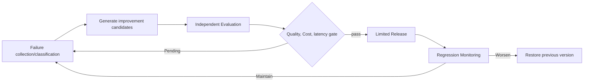

# Continuous Optimization

## Overview

**Continuous Optimization** is an operational loop that collects production failures, independently evaluates improvement candidates, and validates them with limited deployments and rollbacks. Whatever is changed—such as the prompt, retrieval, model weights, tool, or memory—the evaluation criteria and change history must be managed together.

The choice of prompt optimizer and the DSPy compilation example are covered in [[en/AI/Engineering/Prompt_Engineering/Automatic_Prompt_Optimization|Automatic_Prompt_Optimization]], the learning objective in [[en/AI/Engineering/Model_Engineering/Training_and_Tuning/Full_Fine-Tuning|Full_Fine-Tuning]], and the exploration of the entire harness in [[en/AI/Engineering/Loop_Engineering/Self_Evolving_Harnesses|Self_Evolving_Harnesses]].

## From Failure to Deployment



1. **Failure Collection:** Records task success status, tool errors, user modifications, and cost/latency. Personal information is minimized from the collection stage.
2. **Candidate Generation:** Determines the element to change—prompt, retrieval, tool, or model—based on the failure cause. It avoids trying to solve retrieval omissions solely through prompt optimization.
3. **Independent Evaluation:** Compares the baseline and candidates using the same input and evaluation rubric. It checks for regression not only in the average quality but also by failure type.
4. **Limited Deployment:** Deploys to a defined cohort and monitors quality, safety, latency, and cost limits.
5. **Rollback:** Restores a compatible bundle that includes not only the model but also the prompt, retrieval settings, and tool schema.

## Data Leakage and Evaluation Contracts

Train is used for candidate training, development/validation for candidate selection, and held-out test for final evaluation. If similar cases of the same user, conversation, or document span multiple splits, independent evaluation can be compromised, so they are separated by group or time. If candidates are repeatedly revised after inspecting test results, that set is no longer an untouched test set.

Before evaluation, the primary metric, minimum practical effect, sample size/experiment duration, guardrail, and stopping rules are defined. Since comparing many prompt candidates can lead to accidentally high scores, multiple comparisons and iterative observation should be considered. If using an LLM judge, the judge model and rubric should also be fixed and corrected with human evaluation.

## A/B Testing Example

The following code is a runnable educational example for comparing **continuous quality scores of two independent groups**. Verified with Python 3.12 and SciPy 1.18.1. The default `min_samples=30` is an example value for execution and is not the sample size determined by power analysis. In a real service, pre-calculated values are passed. This test is not used for paired comparisons on the same problem or for repeated measurements per user.

Routing is fixed per user in the application. This example analyzes only the already collected scores and returns `winner=None` if the results are not significant or if there is insufficient data. Automatic deployment is not performed before passing the cost/latency gate.

```python
from math import isfinite
from statistics import mean, variance
from scipy.stats import ttest_ind

class ABTestRunner:
    def __init__(self, model_a, model_b, min_samples=30, alpha=0.05, min_effect=0.02):
        if min_samples < 2 or not 0 < alpha < 1 or min_effect < 0:
            raise ValueError("Invalid experiment configuration")
        self.model_a, self.model_b = model_a, model_b
        self.min_samples, self.alpha, self.min_effect = min_samples, alpha, min_effect
        self.results = {"a": [], "b": []}

    def record(self, model_choice: str, quality_score: float):
        if model_choice not in self.results or not isfinite(quality_score):
            raise ValueError("Invalid score or cohort")
        self.results[model_choice].append(quality_score)

    def analyze(self) -> dict:
        a, b = self.results["a"], self.results["b"]
        if any(not isfinite(x) for x in a + b):
            raise ValueError("Scores must be finite")
        result = {
            "model_a_avg": mean(a) if a else None,
            "model_b_avg": mean(b) if b else None,
            "p_value": None, "significant": False, "winner": None,
            "status": "insufficient_data",
        }
        if min(len(a), len(b)) < self.min_samples:
            return result
        if variance(a) == 0 or variance(b) == 0:
            return {**result, "status": "degenerate_data"}
        p = float(ttest_ind(a, b, equal_var=False).pvalue)
        delta = result["model_b_avg"] - result["model_a_avg"]
        significant = isfinite(p) and p < self.alpha
        winner = None
        if significant and abs(delta) >= self.min_effect and delta != 0:
            winner = "b" if delta > 0 else "a"
        return {
            **result, "p_value": p if isfinite(p) else None,
            "significant": significant, "winner": winner,
            "status": "candidate" if winner else "inconclusive",
        }

runner = ABTestRunner(None, None)
runner.results = {
    "a": [0.9] + [0.1, 0.2] * 25,
    "b": [0.1] + [0.8, 0.9] * 25,
}
print(runner.analyze()["winner"])  # b: compare means, not first elements
```

The expected output is `b`. Since the comparison of lists is lexicographical (comparing from the first element), it cannot be used for average quality comparison.

## Change Units and Rollback

| Change Target | What to Record | Response in Case of Failure |
|---|---|---|
| Prompt / DSPy artifact | Model ID, prompt hash, data split, metric | Restore previous artifact |
| Retrieval | embedding model, index version, chunking/filter | Restore index and query settings together |
| Fine-tuning | base model, dataset, objective, checkpoint | Restore traffic to baseline |
| Tool / Memory | schema, policy, data migration | Independently verify external side effects and data compatibility |

## RLVR and Test-Time Compute

RLVR is a learning setup that uses verifiable rewards, and GRPO is an update algorithm. The two terms are not treated as synonyms. Refer to the sections on Verifier design and reward hacking [[en/AI/Engineering/Loop_Engineering/RL_Environments|RL_Environments]], and on learning methods for Full Fine-Tuning.

Test-Time Compute is a method that allocates computation for candidate generation, exploration, and verification during inference, making it a dimension separate from training. Increasing computational load does not necessarily lead to improved quality. Success rate per task, token cost, and p95 latency are measured, and a budget is set based on the diminishing returns of additional computation.

## Role in AI Engineering

Continuous Optimization connects improvement ideas to verifiable deployment changes. Reproducibility, held-out performance, and rollback capability are prioritized over the highest score of the candidate.

## Related Concepts
[[en/AI/Engineering/Loop_Engineering/Data_Flywheel|Data Flywheel]] · [[en/AI/Engineering/Loop_Engineering/Runtime_Optimization|Runtime Optimization]] · [[en/AI/Engineering/Loop_Engineering/RL_Environments|RL Environments]] · [[en/AI/Engineering/Harness_Engineering/Harness_Evaluation/LLM_as_a_Judge|LLM-as-a-Judge]] · [[en/AI/Engineering/Harness_Engineering/Harness_Evaluation/Benchmarking|Benchmarking]] · [[en/AI/Engineering/Model_Engineering/Training_and_Tuning/PEFT_LoRA_QLoRA|PEFT/LoRA/QLoRA]] · [[en/AI/Engineering/Graph_Engineering/Loop_Networks_and_Anchors|Loop Networks and Anchors]] · [[en/AI/Engineering/Loop_Engineering/Cost_Engineering/Cost_Engineering|Cost Engineering]] · [[en/AI/Engineering/Loop_Engineering/Self_Evolving_Harnesses|Self-Evolving Harnesses]]

## Sources
- SciPy, [ttest_ind](https://docs.scipy.org/doc/scipy/reference/generated/scipy.stats.ttest_ind.html) — Welch's t-test and independent samples assumption
- Khattab et al. (2023), [DSPy](https://arxiv.org/abs/2310.03714)
- Shao et al. (2024), [DeepSeekMath](https://arxiv.org/abs/2402.03300)
- DeepSeek-AI (2025), [DeepSeek-R1](https://arxiv.org/abs/2501.12948)
