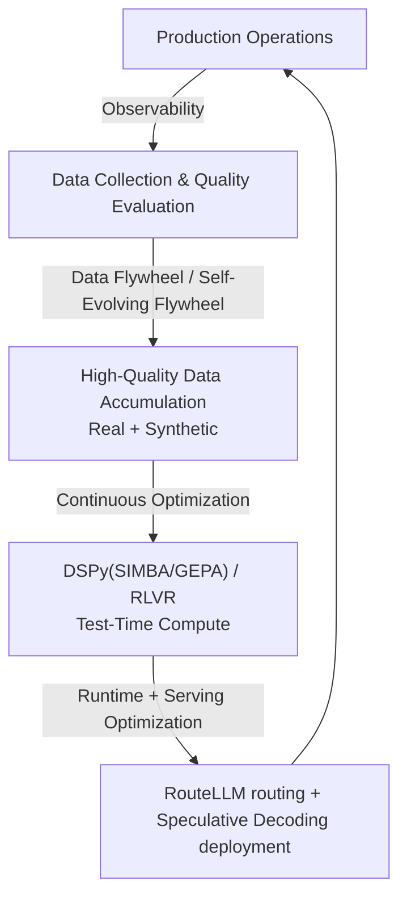

# Loop Engineering

## Overview

**Loop Engineering** is the practice of designing **self-improving cycles** for AI systems even after deployment. Under the principle "deployment is not the end but the beginning," it builds feedback loops that feed production data back into system improvement.



## Sub-documents

| Document | Content |
|------|------|
| [[en/AI/Engineering/Loop_Engineering/Data_Flywheel\|Data_Flywheel]] | Self-Evolving Flywheel, RLVR + Synthetic Data for Self-Reinforcing Data Cycle |
| [[en/AI/Engineering/Loop_Engineering/Continuous_Optimization\|Continuous_Optimization]] | Failure Collection · Held-out Evaluation · A/B · Deployment · Rollback Operation Loop |
| [[en/AI/Engineering/Loop_Engineering/Runtime_Optimization\|Runtime_Optimization]] | API Call Side Optimization — Semantic Cache, Model Routing, Batching, Streaming, Cost Control Loop |
| [[en/AI/Engineering/Loop_Engineering/Production_Operations\|Production_Operations]] | AI Gateway, Deployment Strategy, A/B Testing, SRE/Chaos Engineering, FinOps |
| [[en/AI/Engineering/Loop_Engineering/RL_Environments\|RL_Environments]] | Verifiable Reward Environment for RLVR Training — Gymnasium Lineage, SWE-Gym/GEM/AgentGym, Verifier, Reward Design |
| [[en/AI/Engineering/Loop_Engineering/Self_Evolving_Harnesses\|Self_Evolving_Harnesses]] | Weight-Fixed Harness Evolution Loop — AHE, HarnessEvolve, RRSI, MOSS, Overfitting · Held-out Validation *(2026-10)* |
| [[en/AI/Engineering/Loop_Engineering/Cost_Engineering/Cost_Engineering\|Cost_Engineering]] | Watcher Agent (Agentic FinOps) that Autonomously Decides and Executes Cost Reduction — Model Routing, Task Scripting, Context Usage Auditing (Specialization of Loop Engineering) |
| &nbsp;&nbsp;└ [[en/AI/Engineering/Loop_Engineering/Cost_Engineering/Complexity_Aware_Model_Routing\|Complexity_Aware_Model_Routing]] | FrugalGPT cascade, RouteLLM, UCCI, Budget-Aware Agentic Routing |
| &nbsp;&nbsp;└ [[en/AI/Engineering/Loop_Engineering/Cost_Engineering/Deterministic_Task_Scriptification\|Deterministic_Task_Scriptification]] | Agentic Compilation, Tool-Making, LOOP Skill Engine |
| &nbsp;&nbsp;└ [[en/AI/Engineering/Loop_Engineering/Cost_Engineering/Context_Usage_Auditing\|Context_Usage_Auditing]] | Audit of Retrieved but Unused RAG Context, Automatic Adjustment of retrieval-K |
| [[en/AI/Engineering/Loop_Engineering/Serving_Engineering/Serving_Engineering\|Serving_Engineering]] | Serving Engine Internal Optimization (Infrastructure Layer of Runtime_Optimization) — PagedAttention/RadixAttention, Speculative Decoding, Distributed Serving |
| &nbsp;&nbsp;└ [[en/AI/Engineering/Loop_Engineering/Serving_Engineering/Inference_Internals\|Inference_Internals]] | KV Cache, PagedAttention, Continuous Batching, Chunked Prefill, RadixAttention, FlashAttention |
| &nbsp;&nbsp;└ [[en/AI/Engineering/Loop_Engineering/Serving_Engineering/Speculative_Decoding\|Speculative_Decoding]] | Acceleration based on Draft Models — EAGLE-3, Medusa, n-gram/Prompt Lookup |
| &nbsp;&nbsp;└ [[en/AI/Engineering/Loop_Engineering/Serving_Engineering/Distributed_Serving\|Distributed_Serving]] | Disaggregated Prefill/Decode, KV Cache Transfer, TP/PP/EP, Cold Start |

## What Goes Wrong Without a Loop

```
Static AI system:
  Month 1 — User complaints increase (unknown reason)
  Month 2 — Competitor model improves
  Month 3 — System becomes outdated

With Loop Engineering:
  Month 1 — Failure patterns auto-detected → prompt improved
  Month 2 — Fine-tuned on accumulated data
  Month 3 — Faster improvement than competitors
```

## Role in AI Engineering

Loop Engineering is the **top-level layer that gives AI systems the ability to evolve**. When the data flywheel spins, a network effect occurs where larger user bases drive faster improvement. This becomes the core moat in competition between AI startups and large platforms.

## Related Concepts
[[en/AI/Engineering/Harness_Engineering/Harness_Evaluation/Observability_and_Tracing|Observability & Tracing]] · [[en/AI/Engineering/Harness_Engineering/Harness_Evaluation/LLM_as_a_Judge|LLM-as-a-Judge]] · [[en/AI/Engineering/Model_Engineering/Training_and_Tuning/PEFT_LoRA_QLoRA|PEFT/LoRA/QLoRA]] · [[en/AI/Engineering/Graph_Engineering/Graph_Engineering|Graph Engineering (extends to a network of loops)]]
