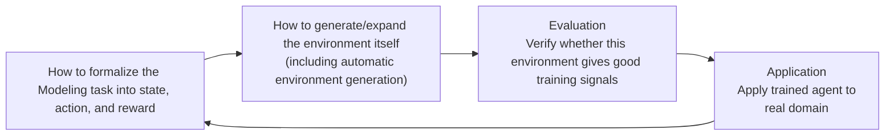

# RL Environments

## Overview

**RL Environments** refers to the **simulated task space** that an agent interacts with when being trained or evaluated using reinforcement learning. While [[en/AI/Engineering/Loop_Engineering/Continuous_Optimization|Continuous_Optimization]] covers the evaluation, deployment, and rollback operational loop for candidates, this document addresses the prerequisite for that learning—**where and how to obtain verifiable reward signals**.

```
RLVR training loop:
  Model generates response → [Reward signal] → Policy update with GRPO

Part covered by this document:
  Where does the reward signal come from?
  → environment to execute the task, verifier to judge correctness, infrastructure to manage the state
```

## Why Environments Became Their Own Engineering Discipline

As RLVR expanded beyond domains with "clearly correct answers" (math, code) into **agentic tasks** (multi-step tool use, long-running workflows), the difficulty of producing a good training signal rose sharply. It's no longer enough to check "does this match the answer string" — you have to judge, in a stateful environment with dozens of tools and hundreds of data tables, whether "this multi-step sequence of actions actually completed the task." Building that judging infrastructure split off from model training itself and became a distinct engineering discipline: RL Environment Engineering.

## The Gymnasium API Lineage

RL environment interfaces largely trace back to OpenAI Gym and its successor, the **Gymnasium** API:

```python
env = make_environment(task="customer_support_ticket_routing")

observation = env.reset()  # returns the initial state
while not done:
    action = agent.act(observation)          # agent selects an action
    observation, reward, terminated, truncated, info = env.step(action)
    # reward: reward for this action
    # terminated: did the episode end via task success/failure
    # truncated: was it force-terminated for exceeding max steps
```

Environments built for LLM agents layer this same skeleton with "action" mapped to a tool call and "observation" mapped to the tool's execution result.

## The 2025–2026 Landscape

"Gym for agents"-style projects have exploded in a short span. Notable ones:

| Environment/Framework | Notes |
|---|---|
| **SWE-Gym** | Based on real GitHub issues — shares SWE-bench's philosophy ("problems real developers filed, not ones researchers made up") |
| **GEM** | Most faithfully follows the Gymnasium API; 24+ built-in games, math, and code environments |
| **RAGEN / VAGEN** | Specialized for multi-turn agents / vision-language agents |
| **AgentGym** | General-purpose framework for collecting and training on agent trajectories |
| **verifiers** | Bundles the broadest set of components — datasets, tools, rubrics, rollout harness, trainer |
| **SkyRL, OpenEnv** | Focused on scalability and distributed execution |
| **WebArena, OSWorld, ToolBench** | Benchmark-cum-environments specialized for web browsing, computer use, and tool use respectively |

Stateful environments have also emerged — for example, one that maintains 164 database tables and 512 tools, where actions in one task genuinely affect the state seen by the next task. In such environments, preventing cross-task contamination (side effects from one episode leaking into the next) becomes its own engineering problem.

## Verifiers: Judging What Counts as "Correct"

A good RL environment needs not just a reward function but a **verifier** — a mechanism, programmatic, model-based, or human, that judges whether an agent's actions were actually correct.

- **Programmatic verifiers**: rule-based scripts that grade automatically — does the code compile, do the tests pass, does the DB state match the expected value. Most trustworthy, but only applicable in verifiable domains.
- **Model-based verifiers**: a separate LLM grades the outcome — reusing the same mechanism as [[en/AI/Engineering/Harness_Engineering/Harness_Evaluation/LLM_as_a_Judge|LLM_as_a_Judge]], but as a training-time reward signal instead of an evaluation-time one.
- **HITL verifiers**: a human grades directly — most expensive, but needed for subjective quality (tone, creativity) that can't be programmatically verified.

**A recent observation in reward design: reward *timing* matters more than reward *content*.** Rewarding only at episode end (outcome reward) trains slowly; rewarding densely at every step risks the agent finding shortcuts to hack the reward. Practice is converging on **hybrid rubrics that combine outcome verification with step-wise scoring**.

## Automated Environment Generation

Rather than authoring environments by hand one at a time, an increasingly common approach has **LLM coding agents write the new environment code itself** — an attempt to get around the pace limit of hand-scaling environment diversity. This approach is still an area where verification and safety assurance are actively catching up.

## Lifecycle Framing: Modeling → Synthesis → Evaluation → Application

The 2026 survey (arXiv:2606.12191) organizes the entire field under the name "Agentic Environment Engineering," grouping the individual techniques discussed above into a single engineering lifecycle.



- **Modeling**: The formalization of state, action, and reward discussed in the "Gymnasium API Genealogy" section applies here.
- **Synthesis**: This includes building existing environments such as SWE-Gym/GEM/AgentGym from the "2025~2026 Landscape" and generating environments based on LLMs from the "Automatic Environment Generation" section.
- **Evaluation**: The core of this stage is the programmatic/model-based/HITL judgment discussed in the "Verifier" section—it verifies the quality of the environment itself (whether the reward is a truly meaningful signal), not the agent.
- **Application**: This is the stage of deploying the trained policy back into the actual domain (customer support, codebase, etc.), which aligns with [[en/AI/Engineering/Loop_Engineering/Data_Flywheel|Data_Flywheel]].

The value of this framing lies in explicitly demonstrating that "building good environments" is not a one-time task but an independent engineering lifecycle that **cycles through Modeling → Generation → Verification → Application**—along with the evaluation and deployment loop in [[en/AI/Engineering/Loop_Engineering/Continuous_Optimization|Continuous_Optimization]], the environment itself requires its own improvement loop.

## Boundary: How are they different from existing concepts?

RL Environments are not a new top-level layer, but rather concepts adjacent to some concepts already covered in this wiki, with a different focus.

| Document | Focus | Relationship with RL Environments |
|---|---|---|
| [[en/AI/Engineering/Harness_Engineering/Harness_Evaluation/Benchmarking\|Harness_Engineering/Harness_Evaluation/Benchmarking]] | **Static** evaluation benchmarks like SWE-bench — measuring model performance without training | The same benchmark (SWE-bench) can be used for evaluation and as an RL training environment (SWE-Gym) — the difference is whether it's "just measuring, or using that signal for training" |
| [[en/AI/Engineering/Harness_Engineering/Harness_Evaluation/Agent_as_a_Judge\|Harness_Engineering/Harness_Evaluation/Agent_as_a_Judge]] | Pre-validating agent behavior using **Agent Simulation** before deployment | The mechanism overlaps with the model-based verifier of RL Environments, but Agent-as-a-Judge is a pre-deployment quality gate, whereas RL Environments provide a reward signal within the training loop. |
| [[en/AI/Engineering/Loop_Engineering/Data_Flywheel\|Loop_Engineering/Data_Flywheel]] | Creating synthetic training data from real data collected in production (loop) | RL Environments differ in that they obtain signals from **pre-designed simulations** rather than production data, but there are cases where the two methods are combined to re-inject production failure cases as new tasks for the RL environment. |
| [[en/AI/Engineering/Loop_Engineering/Continuous_Optimization\|Loop_Engineering/Continuous_Optimization]] | Failure collection · held-out evaluation · A/B · deployment · rollback operational loop | RL Environments provide a reward signal for training, and candidates undergo separate evaluation and deployment loops after training. |

## Role in AI Engineering

RL Environments are the prerequisite infrastructure that makes training techniques like RLVR viable in practice. No matter how good the RL algorithm is, it's useless without a trustworthy reward signal — and by 2025–2026 the industry has recognized that producing that signal (task design, domain expertise, building verifiers, reward design, and running all of this at scale) is itself a substantial engineering investment.

## Related Concepts
[[en/AI/Engineering/Loop_Engineering/Continuous_Optimization|Loop_Engineering/Continuous_Optimization]] · [[en/AI/Engineering/Harness_Engineering/Harness_Evaluation/Benchmarking|Harness_Engineering/Harness_Evaluation/Benchmarking]] · [[en/AI/Engineering/Harness_Engineering/Harness_Evaluation/Agent_as_a_Judge|Harness_Engineering/Harness_Evaluation/Agent_as_a_Judge]] · [[en/AI/Engineering/Loop_Engineering/Data_Flywheel|Loop_Engineering/Data_Flywheel]] · [[en/AI/Engineering/Model_Engineering/Training_and_Tuning/Full_Fine-Tuning|Model_Engineering/Full_Fine-Tuning]]

## Sources
- "A Taxonomy of RL Environments for LLM Agents" (2026) — [leehanchung.github.io](https://leehanchung.github.io/blogs/2026/03/21/rl-environments-for-llm-agents/)
- "The Ultimate Guide to RL Environments: Building and Scaling Them in the LLM Era" (2026) — [adithyask-rl-environments-guide.hf.space](https://adithyask-rl-environments-guide.hf.space/)
- GitHub "awesome-agent-rl-environments" (catalog of SWE-Gym, GEM, RAGEN, AgentGym, WebArena, OSWorld, ToolBench, etc.) — [github.com/v01dmur10c/awesome-agent-rl-environments](https://github.com/v01dmur10c/awesome-agent-rl-environments)
- Jimenez et al. (2023) "SWE-bench: Can Language Models Resolve Real-World GitHub Issues?" — [arXiv:2310.06770](https://arxiv.org/abs/2310.06770)
- (2026) "Agentic Environment Engineering for Large Language Models: A Survey of Environment Modeling, Synthesis, Evaluation, and Application" — [arXiv:2606.12191](https://arxiv.org/abs/2606.12191)
