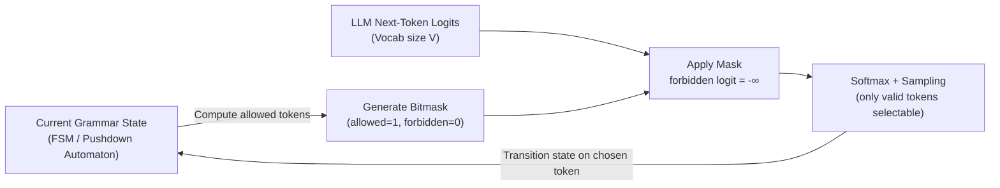

# Constrained Decoding

## Overview

**Constrained Decoding** (Grammar-Guided / Structured Decoding) is a serving-engine technique that **masks the logits of tokens violating a predefined regular expression (Regex) or context-free grammar (CFG) to $-\infty$ inside the token-by-token sampling loop**, mathematically reducing syntax error probability to 0%. While [[en/AI/Engineering/Prompt_Engineering/Structured_Output|Structured_Output]] covers application-layer JSON, schema, and semantic validation contracts, this page covers **how serving engines enforce that structure at the token level**.

## How It Works: FSM / PDA Logit Masking

1. **Grammar Compilation**: Compile JSON Schema, Regex, or EBNF grammar into a Finite State Machine (FSM) or Pushdown Automaton (PDA).
2. **Per-Step Bitmasking**: At each decoding step, apply a vocabulary-sized bitmask (e.g., 128K bits) where only tokens valid from the current state remain `True`, zeroing out probabilities of all invalid tokens.

## Core Engineering Challenges & Solutions

### 1. Token Boundary Mismatch
In subword tokenizers like BPE, a single token such as `"name": "` or `": 123,` spans multiple JSON syntactic elements. Character-level state transitions cannot be applied naively; instead, engines **precompute how every token in the vocabulary transitions FSM states (Precomputed Transition Table / Vocabulary Trie)** during initialization to eliminate runtime latency.

### 2. Jump-Forward Decoding (Deterministic Token Compression)
In JSON generation, spans like `{"user_id": ` or closing quotes/braces `"}` have **only one deterministic valid continuation** under the grammar.
- **Jump-Forward**: In such deterministic spans, the engine skips GPU forward passes, appends the forced string directly to the context, and advances via Prefill (or speculative verification). Consequently, well-engineered constrained decoding can even be **faster than unconstrained decoding** [1][2].

## Engine Comparison

| Engine | Core Technique | Adopted Serving Stack | Characteristics |
|---|---|---|---|
| **Outlines** (`dottxt-ai`) | Regex → FSM + precompiled vocab index | Early vLLM, standalone library | Popularized constrained decoding; Regex and JSON Schema support |
| **XGrammar** | Context-independent token pre-classification + adaptive PDA | **Default in vLLM / SGLang** | <40μs mask generation per token; fast nested CFG handling [3] |
| **llguidance** | Earley parser-based low-overhead scanner + Jump-Forward | **OpenAI Structured Outputs**, vLLM option | Strong on complex recursive grammars and low initialization latency |
| **llama.cpp GBNF** | BNF grammar file stack parser | llama.cpp / Ollama | Lightweight execution in local, CPU, and Apple Silicon environments |

## Precaution: Distribution Distortion

Zero syntax errors do **not** guarantee semantic quality.
- **Premature Grammar Enforcement**: Forcing a JSON field like `{"answer":` before the model has finished reasoning deprives it of thinking tokens and forces it to fill in inaccurate values. For tasks requiring reasoning/CoT, the standard pattern is to allow a `thinking` field or unconstrained reasoning span first, then constrain only the final JSON output.
- **Tokenization Bias**: Masking specific whitespace- or quote-merged tokens subtly alters the model's original probability distribution, so enable strict grammars selectively where schema compliance is required.

## Boundary Clarification

| Document | Scope |
|---|---|
| **This page (Constrained_Decoding)** | Serving-engine **FSM/PDA logit masking, vocabulary indexing, Jump-Forward, XGrammar/Outlines** |
| [[en/AI/Engineering/Prompt_Engineering/Structured_Output\|Structured_Output]] | Application-layer **JSON/Schema/semantic validation separation**, API contracts, failure handling |
| [[en/AI/Engineering/Loop_Engineering/Serving_Engineering/Inference_Internals\|Inference_Internals]] | General inference loop optimizations: KV Cache, PagedAttention, RadixAttention |

## Role in AI Engineering

Constrained Decoding is the **reliability substrate** for agent tool calling (Function Calling), enterprise data extraction (ETL), and syntax-guaranteed NL2SQL pipelines. It eliminates parsing failures that previously required regex retry loops at the serving-engine layer and saves decoding steps via Jump-Forward.

## Related Concepts
[[en/AI/Engineering/Prompt_Engineering/Structured_Output|Structured_Output]] · [[en/AI/Engineering/Loop_Engineering/Serving_Engineering/Inference_Internals|Inference_Internals]] · [[en/AI/Engineering/Loop_Engineering/Serving_Engineering/Serving_Engineering|Serving_Engineering]] · [[en/AI/Engineering/Flow_Engineering/Linear_Flow/Tool_Use_and_Function_Calling|Tool_Use_and_Function_Calling]]

## Sources
- [1] Willard & Louf (2023) "Efficient Guided Generation for Large Language Models (Outlines)" — [arXiv:2307.09702](https://arxiv.org/abs/2307.09702)
- [2] Zheng et al. (2024) "SGLang: Efficient Execution of Structured Language Model Programs" — [arXiv:2312.07104](https://arxiv.org/abs/2312.07104)
- [3] Dong et al. (2024) "XGrammar: Flexible and Efficient Structured Generation Engine for Large Language Models" — [arXiv:2411.15100](https://arxiv.org/abs/2411.15100)
- Microsoft "llguidance" — [github.com/guidance-ai/llguidance](https://github.com/guidance-ai/llguidance)
