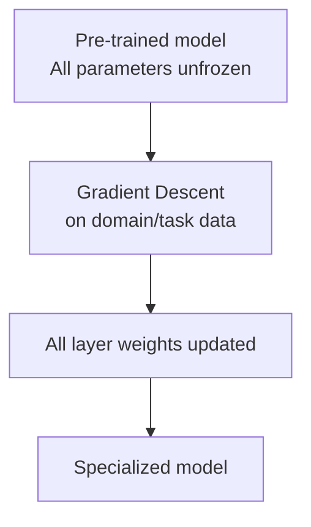
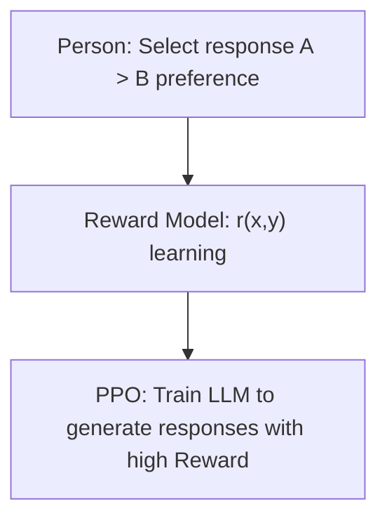

# Full Fine-Tuning

## Overview

**Full Fine-Tuning** is a technique that retrains **all parameters** of a pre-trained model using task-specific or domain-specific data. It is a term that defines the scope of parameters to be updated, not the learning objective. SFT, DPO, and RL can be applied to both Full FT and PEFT. Performance and cost vary depending on the data, model, and training setup.

## How It Works



### SFT (Supervised Fine-Tuning)

The most common form of Full FT. Supervised learning with input→output pairs:

```python
# Training data example (Instruction Tuning format)
{
    "instruction": "Review the following contract and identify risky clauses.",
    "input": "<contract content>",
    "output": "Risk clause 1: Article 5, Section 3 - Unilateral termination conditions..."
}
```

### RLHF (Reinforcement Learning from Human Feedback)

Technique used in OpenAI's InstructGPT and ChatGPT:

1. **SFT Stage**: Training the base model with high-quality demonstration data
2. **Reward Model Training**: Human evaluators compare response pairs → Preference labels → Training the Reward Model
3. **PPO Optimization**: Fine-tuning the LLM using RL (PPO algorithm) to maximize the Reward



**DPO (Direct Preference Optimization)**: Optimizes directly using preference data, skipping the training of the Reward Model in RLHF. It is a direct preference optimization method that does not involve a separate reward model or PPO loop, and its stability and performance depend on the data and settings.

### Next Steps in Lineage: GRPO / RLVR

**GRPO (Group Relative Policy Optimization)** is a PPO-family algorithm proposed in DeepSeekMath (2024). It estimates the advantage using the mean and standard deviation of rewards for responses generated from the same prompt, thus eliminating the need for a separate value model. It is not a simple rank-based update, and the absence of a critic does not always guarantee learning stability.

**RLVR (Reinforcement Learning with Verifiable Rewards)** is a training setup where rewards are calculated using answer validators and execution tests. GRPO and RLVR are on different axes, representing different algorithmic and reward construction methods, respectively. DeepSeek-R1 (2025) is an example of applying this approach to reasoning learning. The potential for verifier omissions/workarounds and reward hacking must be evaluated.

The process of creating candidates from operational data and subsequently verifying and deploying them is covered in [[en/AI/Engineering/Loop_Engineering/Continuous_Optimization|Continuous_Optimization]], while the design of the verifier and environment is discussed in [[en/AI/Engineering/Loop_Engineering/RL_Environments|RL_Environments]].

## Full FT vs PEFT Comparison

| Criterion | Full Fine-Tuning | PEFT (LoRA, etc.) |
|------|-----------------|---------------|
| **Training Parameters** | All parameters | Some adapters, etc.; ratio depends on rank and target module |
| **GPU Memory** | Requires full gradient and optimizer state | Training state is reduced, but base model and activation memory are required |
| **Performance** | Allows for broader parameter changes; not always superior | Needs comparison with Full FT depending on data, rank, and task |
| **Training Time** | Depends on model, parallelization, and sequence length | Optimizer burden is small, but forward/backward costs remain |
| **Catastrophic Forgetting** | Possible; requires regression evaluation of previously acquired capabilities | Possible even with PEFT; requires separate evaluation |
| **Suitable Cases** | Tasks where the benefit of full update justifies the cost | Tasks where the adapter effect is validated under limited training resources |

## Appropriate Scenarios

- When the fundamental behavior patterns of the model need to be changed (safety, policy compliance)
- When sufficient computing resources are available
- When representative, high-quality training data and independent evaluation data have been secured; a fixed minimum data count is not applied
- When specific output formats or languages need to be deeply internalized by the model

## Cost Optimization

```
Full FT memory = parameter × (weight + gradient + optimizer state)
  = 7B parameters × (2 + 2 + 8 bytes) = ~84 GB (weights·gradient BF16, Adam moments FP32)

If separate FP32 master weights are maintained, it adds about 28 GB (7B × 4 bytes)
Activation·Temporary buffer·Communication·allocator overhead is separate
→ Actual peak memory is measured including implementation and sequence length
```

- **Gradient Checkpointing**: Discarding intermediate activations and recalculating them during backpropagation → memory saving
- **DeepSpeed ZeRO**: Distributing optimizer states, gradients, and parameters across multiple GPUs

## Roles in AI Engineering

Compare and select between Full FT and LoRA/QLoRA (→ [[en/AI/Engineering/Model_Engineering/Training_and_Tuning/PEFT_LoRA_QLoRA|PEFT_LoRA_QLoRA]]) under identical data and evaluation conditions. Full FT is a candidate when it is difficult to achieve the goal with only adapters and when the entire update cost can be managed.

## Related Concepts
[[en/AI/Engineering/Model_Engineering/Training_and_Tuning/Pre-training_and_Continual_Learning|Pre-training & Continual Learning]] · [[en/AI/Engineering/Model_Engineering/Training_and_Tuning/PEFT_LoRA_QLoRA|PEFT_LoRA_QLoRA]] · [[en/AI/Engineering/Model_Engineering/Training_and_Tuning/Model_Distillation|Model Distillation]] · [[en/AI/Engineering/Loop_Engineering/Continuous_Optimization|Loop_Engineering/Continuous_Optimization]]

## References
- Ouyang et al. (2022) "Training language models to follow instructions with human feedback" (InstructGPT) — [arXiv:2203.02155](https://arxiv.org/abs/2203.02155)
- Rafailov et al. (2023) "Direct Preference Optimization" — [arXiv:2305.18290](https://arxiv.org/abs/2305.18290)
- Karpathy, A. "Let's reproduce GPT-2" — [YouTube](https://www.youtube.com/watch?v=l8pRSuU81PU)
- DeepSeek-AI (2025) "DeepSeek-R1: Incentivizing Reasoning Capability in LLMs via Reinforcement Learning" — [arXiv:2501.12948](https://arxiv.org/abs/2501.12948)

- Shao et al. (2024), [DeepSeekMath](https://arxiv.org/abs/2402.03300) — Proposed GRPO
