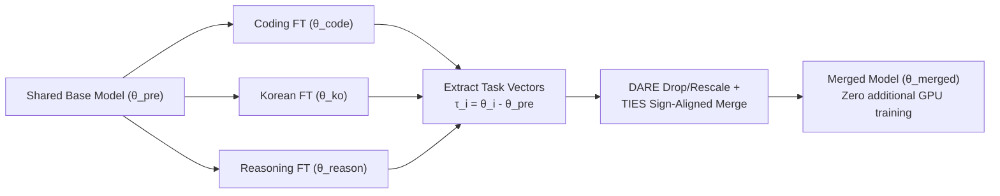

# Model Merging

## Overview

**Model Merging** combines the **weights (or LoRA adapters) of multiple models fine-tuned from the same pre-trained base model directly in parameter space**—without additional GPU training or training data—to obtain multi-domain capabilities and stronger generalization. In the open-weight ecosystem, it is a core technique for rapidly assembling custom models from specialized variants (coding, math, instruction-following).

## Why It Works: Shared Loss Basins

Simply averaging weights of two models pre-trained independently from different random seeds destroys performance. In contrast, **models fine-tuned from the same base model $\theta_{\text{pre}}$** ($\theta_1, \theta_2, \dots$) tend to remain in the same flat, low-loss basin in parameter space, allowing linear or vector arithmetic combinations to merge capabilities without collapse [1].

## Major Merging Algorithms

| Algorithm | Core Formula / Principle | Problem Solved | Source |
|---|---|---|---|
| **Model Soups (Linear)** | $\theta = \sum w_i \theta_i$ | Reduces variance and improves accuracy across checkpoints of the same task | Wortsman et al. (ICML 2022) [1] |
| **SLERP** | Spherical linear interpolation in high dimensions | Prevents weight-norm shrinkage caused by naive linear averaging | Shoemake (1985) / MergeKit |
| **Task Arithmetic** | $\tau_t = \theta_t - \theta_{\text{pre}}$, $\theta = \theta_{\text{pre}} + \sum \lambda_t \tau_t$ | Combines capabilities via task-vector addition; removes unwanted behaviors (unlearning) via subtraction ($-\lambda \tau$) | Ilharco et al. (ICLR 2023) [2] |
| **TIES-Merging** | **T**rim (low-magnitude) → **E**lect Sign (majority) → Di**s**joint Merge | Resolves sign conflicts and redundant parameter interference across task vectors | Yadav et al. (NeurIPS 2023) [3] |
| **DARE** | Randomly drop 90–99% of delta parameters ($\tau_t$) and rescale by $1/(1-p)$ | Preserves capability under extreme sparsification; minimizes interference before TIES/Linear merge | Yu et al. (ICML 2024) [4] |
| **Evolutionary Merge** | Searches weight combinations and layer-wise splicing (passthrough) recipes via evolutionary algorithms | Overcomes manual tuning limits; optimizes cross-domain combinations | Akiba et al. / Sakana AI (2024) [5] |



## Practical Implementation: MergeKit

The open-source standard tool `mergekit` can stream layer-by-layer merges even on CPU:

```yaml
# Example mergekit YAML configuration (DARE-TIES merge)
models:
  - model: Qwen/Qwen2.5-7B-Instruct
    # base_model anchor
  - model: org/qwen2.5-7b-korean-ft
    parameters:
      density: 0.55   # DARE: drop 45% of delta parameters
      weight: 0.5
  - model: org/qwen2.5-7b-code-ft
    parameters:
      density: 0.55
      weight: 0.5
merge_method: dare_ties
base_model: Qwen/Qwen2.5-7B-Instruct
parameters:
  normalize: true
dtype: bfloat16
```

## Boundary Clarification: Ensemble, Distillation, and Multi-LoRA

| Approach | Inference Cost (Serving) | Extra Training | Best Suited For |
|---|---|---|---|
| **Model Merging** | **1× (single model)** | None (minutes on CPU) | Permanently unifying derivatives of the same base model into one weight set |
| **Multi-LoRA Serving** | ~1× (dynamic per-batch switching) | Per-adapter training | Runtime selection of tenant/task-isolated adapters |
| **Model Distillation** | 1× (smaller Student) | Required (high cost) | Compressing knowledge across different architectures or model sizes |
| **Ensemble / Routing** | $K\times$ or router overhead | None | Combining outputs from heterogeneous models with different bases |

## Limitations & Precautions

- **Same Architecture & Ancestor Constraint**: Merging across different architectures or unrelated pre-trained checkpoints is generally infeasible due to tokenizer and layer-dimension mismatches.
- **Task Interference**: Merging models with conflicting instruction formats or safety alignments can weaken alignment or degrade outputs; always re-run benchmark and safety evaluations after merging.

## Role in AI Engineering

Model Merging provides **Zero-Training model customization**. When combining an in-house domain model (via SFT/DPO) with open-source reasoning or coding specialists, teams can synthesize and validate candidate models in minutes without re-training on combined datasets.

## Related Concepts
[[en/AI/Engineering/Model_Engineering/Training_and_Tuning/Full_Fine-Tuning|Full_Fine-Tuning]] · [[en/AI/Engineering/Model_Engineering/Training_and_Tuning/PEFT_LoRA_QLoRA|PEFT_LoRA_QLoRA]] · [[en/AI/Engineering/Model_Engineering/Training_and_Tuning/Model_Distillation|Model_Distillation]] · [[en/AI/Engineering/Harness_Engineering/Harness_Evaluation/Benchmarking|Benchmarking]]

## Sources
- [1] Wortsman et al. (2022) "Model soups: averaging weights of multiple fine-tuned models improves accuracy without increasing inference time" — [arXiv:2203.05482](https://arxiv.org/abs/2203.05482)
- [2] Ilharco et al. (2023) "Editing Models with Task Arithmetic" — [arXiv:2212.04089](https://arxiv.org/abs/2212.04089)
- [3] Yadav et al. (2023) "TIES-Merging: Resolving Interference When Merging Models" — [arXiv:2306.01708](https://arxiv.org/abs/2306.01708)
- [4] Yu et al. (2024) "Language Models are Super Mario: Absorbing Abilities from Homologous Models as a Free Lunch (DARE)" — [arXiv:2311.03099](https://arxiv.org/abs/2311.03099)
- [5] Akiba et al. (2024) "Evolutionary Optimization of Model Merging Recipes" — [arXiv:2403.13187](https://arxiv.org/abs/2403.13187)
- Goddard et al. (2024) "Arcee's MergeKit: A Toolkit for Merging Large Language Models" — [arXiv:2403.13257](https://arxiv.org/abs/2403.13257)
