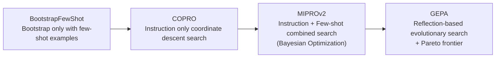

# Automatic Prompt Optimization

## Overview

**Automatic Prompt Optimization** is an approach where, instead of manually writing prompts, an optimizer automatically searches for prompt wording, few-shot examples, and instruction structure based only on the goal and evaluation metrics. It has begun to take root in practice since late 2024, embodying a shift in perspective from "writing" prompts to "compiling" them.

This document covers the paradigm shift itself and **when and which optimizer to use**. It also explains the minimum configuration of DSPy compilation, while independent evaluation, deployment, and rollback operational loops are discussed in [[en/AI/Engineering/Loop_Engineering/Continuous_Optimization|Continuous_Optimization]].

## Why Hand-Written Prompting Has Structural Limits

```
Structural problems with manual prompt engineering:
  - Human intuition can diverge from a model's actual response patterns
    (the intuition "asking politely will make it comply better" isn't always right)
  - Every small change to a prompt requires manually re-evaluating the whole pipeline
  - When the model changes (GPT-4→GPT-5, Claude 3.5→4.5), the old prompt is no longer optimal
    → manual retuning is needed at every model upgrade
  - In multi-step pipelines (RAG, agents), prompts at different stages interact with each
    other, making it hard for a human to intuit the globally optimal combination
```

## Automatic Optimization Techniques Landscape

| Technique | Method | Characteristics |
|------|------|------|
| **APE** (Automatic Prompt Engineer) | Reverse-generates candidate instructions from demonstration examples for the LLM and scores them | The initial generation of the "LLM writing LLM prompts" approach (Zhou et al., 2022) |
| **OPRO** (Optimization by PROmpting) | Uses the LLM itself as a meta-optimization algorithm — feeds previous attempts and scores into the prompt to generate the next candidate | Optimizes using only a pure natural language feedback loop without gradients |
| **TextGrad** | "Text-based Backpropagation" — treats evaluation feedback as a differentiable loss and propagates it to the prompts of each node in the pipeline | Optimizes the entire multi-step pipeline simultaneously |
| **Vendor Prompt Improver** | One-time prompt improvement tools built into consoles by Anthropic/OpenAI | Instantly usable without building a separate pipeline, but not a repetitive optimization loop |
| **DSPy Optimizer Series** | Compiler explores prompts + examples upon declaring signatures, modules, and metrics | Refer to the selection guide and compilation examples below |

## GEPA (ICLR 2026) — Reflection-based Evolutionary Search

**GEPA**(Genetic-Pareto) is an optimizer included in DSPy 3.0, presented at ICLR 2026. The core difference lies in its distinction from existing RL-based optimization (GRPO).

```
GRPO (RL-based) method:
  Gradually update the policy using only the reward signal
  → Large-scale rollout (thousands to tens of thousands of times) is required

GEPA (Reflection-based Evolution) method:
  Execute mini-batch for each iteration → Generate natural language reflection on the execution trajectory
  → Analyze "Why is this response wrong?" as text and directly modify the prompt
  → Maintain and select the revised candidates by Pareto frontier (considering the complementarity of performance for each case)
```

The GEPA paper v2 (2026-02-14) reports an average improvement of 6% and a maximum improvement of 20% over GRPO across **6 tasks**, with up to 35 times fewer rollouts. These results are obtained from the model, task, and budget settings of the paper and do not guarantee improvement across all workloads. Rollout count is not total cost; include the reflection model’s cost when making comparisons.

## DSPy Optimizer Selection Guide

DSPy is a representative framework for the approach of "prompt compilation." Optimizer lineage and their respective trade-offs:



| Scenario | Recommended Optimizer |
|------|-----------------|
| Simple tasks where selecting a few good examples is sufficient | BootstrapFewShot |
| When the instruction prompt itself is important and examples are unnecessary | COPRO |
| General cases where examples and instructions need to be explored together | MIPROv2 |
| When useful natural language feedback can be obtained from the execution trajectory | GEPA |
| When the model weights themselves need to be changed | Review the training pipeline separately from the prompt optimizer; refer to [[en/AI/Engineering/Model_Engineering/Training_and_Tuning/Full_Fine-Tuning\|Full_Fine-Tuning]] for GRPO, etc. |

## DSPy Compilation Configuration

This is a **descriptive API example** based on DSPy 3.4.1 and Python 3.12. We have verified the SDK import and object configuration, but we have not executed the paid LM calls or optimizer training. `DSPY_MODEL` is the LiteLLM provider/model identifier, and provider authentication and available models are required. The toy dataset below is for demonstrating API connectivity and is not a basis for quality claims.

```python
import os
import dspy

dspy.configure(lm=dspy.LM(os.environ["DSPY_MODEL"]))

class Classify(dspy.Signature):
    """Classify sentiment as positive or negative."""
    text: str = dspy.InputField()
    label: str = dspy.OutputField()

program = dspy.Predict(Classify)
train = [
    dspy.Example(text="Useful and reliable.", label="positive").with_inputs("text"),
    dspy.Example(text="It fails repeatedly.", label="negative").with_inputs("text"),
]
validation = [
    dspy.Example(text="I would use this again.", label="positive").with_inputs("text"),
    dspy.Example(text="I regret buying this.", label="negative").with_inputs("text"),
]

def metric(example, prediction, trace=None):
    return prediction.label.strip().lower() == example.label

optimizer = dspy.MIPROv2(metric=metric, auto="light")
optimized = optimizer.compile(program, trainset=train, valset=validation)
optimized.save("sentiment-program.json")
```

For practical application, sufficient representative examples and a separate held-out test are required. `trainset` and `valset` are used by the optimizer for candidate exploration, so the final quality is measured in a test independent of both. The original program and compiled artifact are compared using the same model and metric, and call count and token cost are also recorded.

## Application Conditions and Failure Modes

- If there are no metrics and representative data to distinguish errors, the optimizer will optimize for the wrong objective. First, check for Judge bias, answer leakage, and length bias.
- MIPROv2 explores combinations of instructions and few-shot examples. GEPA is reviewed when reflection on the trajectory is useful. Do not judge superiority based solely on the algorithm name.
- Re-evaluate the artifact if the model, tool schema, or retrieval distribution changes. Do not deploy based solely on an increase in validation scores.
- Improving only easy problems can lead to the deterioration of critical minority tasks. Compare performance, failure rates, and cost/latency for each error type.

## Boundary Definition

| Document | Covers |
|------|-----------|
| **This Document (Automatic_Prompt_Optimization)** | Prompt candidate search · optimizer selection · DSPy compilation configuration |
| [[en/AI/Engineering/Loop_Engineering/Continuous_Optimization\|Continuous_Optimization]] | **Operational loop** including failure collection · independent evaluation · A/B · version management · rollback |

## Role in AI Engineering

Automatic prompt optimization is a technique that bridges Prompt Engineering and Loop Engineering — the output is still a "prompt" (the subject of Prompt Engineering), but the process of creating it follows an iterative evaluation and improvement loop (the methodology of Loop Engineering). As the cost of manually re-tuning prompts becomes non-negligible in large organizations whenever the model is upgraded, it is useful in pipelines that are reused enough to recoup the cost of automated exploration. Simple tasks are first compared against a manual baseline.

## Related Concepts
[[en/AI/Engineering/Loop_Engineering/Continuous_Optimization|Continuous Optimization]] · [[en/AI/Engineering/Prompt_Engineering/Few_shot_Prompting|Few-shot Prompting]] · [[en/AI/Engineering/Prompt_Engineering/System_and_Role_Prompting|System & Role Prompting]] · [[en/AI/Engineering/Harness_Engineering/Harness_Evaluation/LLM_as_a_Judge|LLM-as-a-Judge]] · [[en/AI/Engineering/Loop_Engineering/Self_Evolving_Harnesses|Self-Evolving Harnesses]]

## References
- Zhou et al. (2022) "Large Language Models Are Human-Level Prompt Engineers (APE)" — [arXiv:2211.01910](https://arxiv.org/abs/2211.01910)
- Yang et al. (2023) "Large Language Models as Optimizers (OPRO)" — [arXiv:2309.03409](https://arxiv.org/abs/2309.03409)
- Yuksekgonul et al. (2024) "TextGrad: Automatic Differentiation via Text" — [arXiv:2406.07496](https://arxiv.org/abs/2406.07496)
- Khattab et al. (2023) "DSPy: Compiling Declarative Language Model Calls into Self-Improving Pipelines" — [arXiv:2310.03714](https://arxiv.org/abs/2310.03714)
- Agrawal et al. (2026) "GEPA: Reflective Prompt Evolution Can Outperform Reinforcement Learning" (ICLR 2026) — [arXiv:2507.19457](https://arxiv.org/abs/2507.19457)

- DSPy, [MIPROv2 API](https://dspy.ai/api/optimizers/MIPROv2/)
- DSPy, [Optimizers](https://dspy.ai/learn/optimization/optimizers/)
