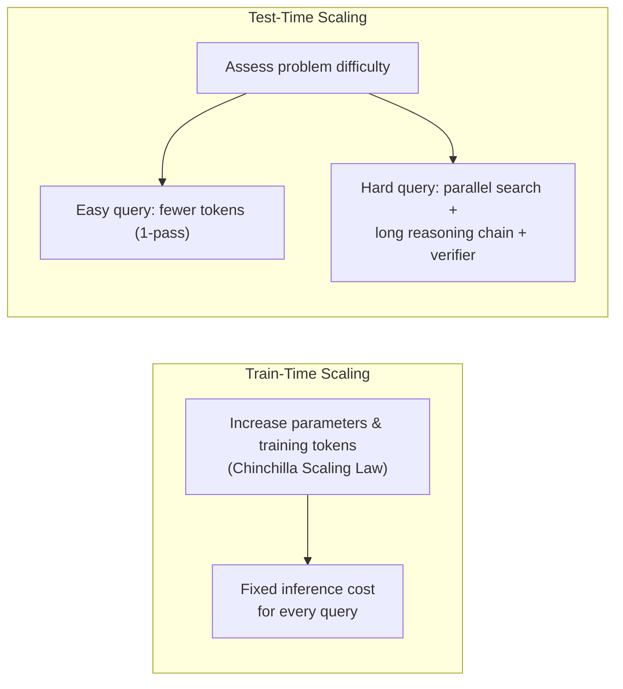

# Test-Time Compute Scaling

## Overview

**Test-Time Compute Scaling** is a paradigm that improves accuracy on complex problems by **allocating more compute budget at inference time (token count, number of candidate samples, and search depth)** rather than increasing model weights during pre-training or fine-tuning. After Snell et al. (2024) demonstrated that scaling inference-time compute can outperform scaling model parameters by 14× within certain difficulty regimes, it has become an independent design axis beyond simple CoT prompting [1].

## Train-Time vs Test-Time Scaling

## Three Scaling Axes

### 1. Parallel Scaling (Parallel Sampling & Verification)
Generate $N$ independent reasoning paths from the same prompt in parallel and select the best answer.
- **Majority Voting (Self-Consistency)**: Select the most frequent final answer (suitable for tasks with normalized outputs such as math or multiple-choice).
- **Best-of-N with Verifier**: Score $N$ candidates using a separate reward model (ORM/PRM) or an execution-based verifier (unit tests, compiler) and return the highest-scoring candidate.

### 2. Sequential Scaling (Extended Reasoning & Self-Revision)
Build upon intermediate reasoning and failure feedback from prior attempts within the same thread to deepen reasoning.
- **Iterative Revision**: Sequentially repeat draft generation → error checking → revision steps.
- **Budget Forcing (`s1`)**: A simple control technique proposed by Muennighoff et al. (2025) that injects continuation tokens such as `"Wait"` when the model attempts to emit an end-of-thinking token to extend reasoning, or forces an end delimiter when the budget limit is reached [2].

### 3. Search with Verifiers (Verifier-Guided Tree Search)
Combine parallel and sequential scaling to retain promising branches at intermediate steps and prune failing branches early.
- **Step-level Beam Search / Lookahead Search**: Generate multiple next-step candidates at each reasoning step, keep only the top-$B$ paths scored by a **PRM (Process Reward Model)**, and search to completion [1].

## ORM vs PRM (Reward Model Design)

| Type | ORM (Outcome Reward Model) | PRM (Process Reward Model) |
|---|---|---|
| **Scored Target** | Evaluates only correctness of the final answer | Scores logical validity **at each intermediate reasoning step** |
| **Strength** | Trainable with final answer labels alone (easy data curation) | Prunes invalid intermediate steps early; higher search efficiency |
| **Limitation** | Rewards flawed reasoning paths that happen to reach the right answer | High step-level labeling cost and risk of Reward Hacking |
| **Key Work** | Cobbe et al. (GSM8K Verifier) | Lightman et al. (2023) "Let's Verify Step by Step" [3] |

## Compute-Optimal Allocation & Overthinking

Increasing inference budget unconditionally does not yield proportional gains.
- **Difficulty-Aware Strategy**: Applying long reasoning or heavy beam search to trivial problems inflates cost and can induce **Overthinking**, where the model flips an already-correct answer into an error. Conversely, very hard problems benefit more from verifier-guided search or parallel sampling than from a single long reasoning trace.
- **Production Pattern**: Apply **Compute-Optimal routing** that classifies incoming query difficulty upfront to dynamically tune `reasoning_effort` / `thinking_budget` and the $N$ in Best-of-N.

## Boundary Clarification

| Document | Scope |
|---|---|
| **This page (Test_Time_Compute_Scaling)** | **Inference-time compute allocation axes (Parallel/Sequential/Search)**, ORM/PRM verifiers, Compute-Optimal strategy |
| [[en/AI/Engineering/Prompt_Engineering/Chain_of_Thought\|Chain_of_Thought]] | CoT/ToT prompting techniques and overview of `thinking_budget` APIs in reasoning models |
| [[en/AI/Engineering/Loop_Engineering/Continuous_Optimization\|Continuous_Optimization]] | **Training-time** optimization such as RLVR (GRPO) and operational loops |
| [[en/AI/Engineering/Loop_Engineering/Cost_Engineering/Complexity_Aware_Model_Routing\|Complexity_Aware_Model_Routing]] | Routing **model size and budget** by request complexity |

## Role in AI Engineering

Test-Time Compute Scaling moves architectures beyond "calling the most expensive frontier model once per request," enabling **dynamic investment of reasoning tokens and verification compute proportional to query difficulty**. It is a primary lever for maximizing performance per dollar in code generation (paired with unit-test verifiers), mathematical/logical reasoning, and complex planning.

## Related Concepts
[[en/AI/Engineering/Prompt_Engineering/Chain_of_Thought|Chain_of_Thought]] · [[en/AI/Engineering/Prompt_Engineering/Sampling_Controls|Sampling_Controls]] · [[en/AI/Engineering/Loop_Engineering/Continuous_Optimization|Continuous_Optimization]] · [[en/AI/Engineering/Loop_Engineering/Cost_Engineering/Complexity_Aware_Model_Routing|Complexity_Aware_Model_Routing]] · [[en/AI/Engineering/Model_Engineering/Training_and_Tuning/Full_Fine-Tuning|Full_Fine-Tuning]]

## Sources
- [1] Snell et al. (2024) "Scaling LLM Test-Time Compute Optimally can be More Effective than Scaling Model Parameters" — [arXiv:2408.03314](https://arxiv.org/abs/2408.03314)
- [2] Muennighoff et al. (2025) "s1: Simple test-time scaling" — [arXiv:2501.19393](https://arxiv.org/abs/2501.19393)
- [3] Lightman et al. (2023) "Let's Verify Step by Step" — [arXiv:2305.20050](https://arxiv.org/abs/2305.20050)
